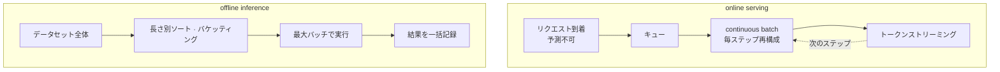
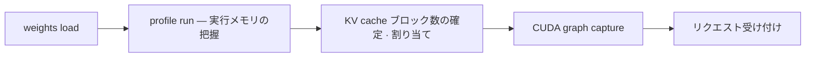
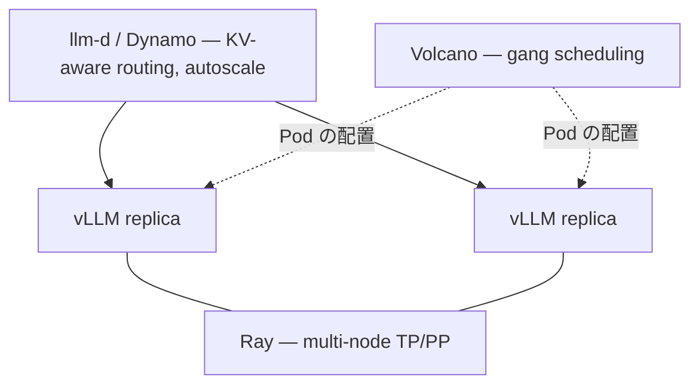
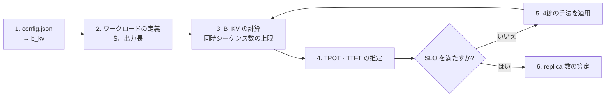

> AI 需要の増加により、モダンな LLM サービングエンジンの構築事例が増えている。現時点で AR-LLM のサービング環境の構成に必要な意思決定と、既知の考慮事項を概括的に整理してみた。modality や performance technic などは対象外とした。


## 1. What Actually deploys?

モデルをデプロイするというのは、重みファイルを1つ移す作業ではない。以下の5つがすべて揃って初めて、学習時と同じ出力が得られる。

| 構成 | ファイル | 欠けたときに起きること |
|---|---|---|
| 重み | `*.safetensors` | モデルを実行できない |
| アーキテクチャ定義 | `config.json` | 重みをどのグラフに載せるのか分からない |
| トークナイザ | `tokenizer.json`, `tokenizer_config.json` | 同じ文が異なるトークン列に変換される |
| 対話形式 | chat template | 学習時と異なる形式のプロンプトがモデルに入る |
| 実行コード | ランタイム + カーネル | 同じ重みでもスループットが数十倍変わる |

```text
meta-llama/Llama-3.1-8B-Instruct/
├── config.json                  # アーキテクチャ — 3節の計算の入力
├── generation_config.json       # サンプリングのデフォルト値
├── model-0000{1..4}-of-00004.safetensors   # 重み 16.1 GB
├── model.safetensors.index.json # テンソルとファイルの対応表
├── tokenizer.json
└── tokenizer_config.json        # chat template を含む
```

サービングの観点で最も重要なファイルは `config.json` である。モデルを起動する前に、このファイルだけで GPU が何枚必要か、同時に何件のリクエストを受けられるかを計算できる。

```json
{
  "num_hidden_layers": 32,
  "num_attention_heads": 32,
  "num_key_value_heads": 8,
  "head_dim": 128,
  "torch_dtype": "bfloat16"
}
```

| フィールド | サービングで決まる値 |
|---|---|
| `num_hidden_layers` | KV cache のサイズがこの値に比例する |
| `num_key_value_heads` | `num_attention_heads` より小さければ GQA である。2つの値の比率の分だけ KV cache が小さくなる |
| `head_dim` | KV cache のサイズがこの値に比例する |
| `torch_dtype` | 重みのメモリを決める。bf16 ならパラメータ数 × 2 バイト |

上のモデルは attention head が32個、KV head が8個なので GQA 4:1 である。MHA であれば KV cache が4倍必要だった。

重みのメモリは、パラメータ数に定数を掛ければ求まる。KV cache は、これに同時リクエスト数とコンテキスト長がさらに掛かる。サービングでメモリ計算が難しくなる理由はこの違いにある。

## 2. サービングエンジンの主な機能と目的

### 2.1 target device

同じモデルでも、どこに配置するかによって最適化の対象が変わる。

| 方式 | 制約 | 最適化対象 | 例 |
|---|---|---|---|
| on-device | メモリ・電力・発熱 | モデルサイズ、量子化 | llama.cpp, CoreML |
| single-model | GPU メモリ | latency, throughput | vLLM 単一 replica |
| multi-model | 分離、モデル切り替えコスト | GPU 占有率、cold start | LoRA マルチアダプタ |
| platform | 運用の複雑さ | ルーティング、オートスケール | KServe, llm-d, Ray Serve |

この記事では single-model から platform までを扱う。

### 2.2 Online serving vs Offline inference

オンライン推論とオフライン推論は同じエンジンと同じモデルを使うが、ワークロードの使われ方によって考慮事項が異なる。
Request の形態によって、以下のように区分できる。



オンライン推論では、バッチを事前に構成できない。いま GPU にどのリクエストを載せるかを決める時点でも、次のリクエストがいつ到着するか分からないからだ。そのため毎ステップバッチを再構成する必要があり(4.1)、到着率が処理率を超えるとキューが溜まり、p99 レイテンシが崩れる。

オフライン推論は、入力全体を把握したうえで開始する。長さが近いリクエスト同士をまとめてパディングの無駄をなくせるうえ、守るべきレイテンシ目標がないため、バッチサイズをメモリの限界まで大きくできる。

| | online | offline (batch) |
|---|---|---|
| 代表的なワークロード | チャットボット、コードアシスタント、API | 埋め込み生成、ラベリング、評価セットの推論、文書の一括要約 |
| 目的関数 | latency SLO (TTFT, TPOT) | throughput、1M トークンあたりのコスト |
| 到着パターン | 確率的。ピークと谷がある | 決定的。全量を把握したうえで開始する |
| バッチ構成 | 到着順の continuous batching | 長さでソートした後、最大バッチ |
| ストリーミング | 必要である。体感速度が TTFT で決まる | 不要である |
| バッチサイズの上限 | SLO | メモリ | 
| 障害モード | キュー待ちの急増、p99 の崩壊 | OOM |
| スケールの基準 | ピークトラフィック | 締め切り時刻 |

3節以降はオンライン推論を基準に記述する。ただし、4節の最適化手法はオフライン推論のほうが効果が大きく現れる。バッチサイズを SLO ではなく、メモリが許す限り大きくできるからだ。

### 2.3 起動 lifecycle — Startup

LLM サービングは、起動段階で一般的なモデルデプロイと分かれる。起動が終わった時点で、その replica が処理できる同時リクエスト数が確定するからだ。



順序には理由がある。エンジンはダミーの forward を1回実行し、アクティベーションと実行バッファがどれだけ必要かを把握したうえで、残りのメモリすべてを KV cache として事前に割り当てる。CUDA graph はその後に capture する。リクエストごとに KV メモリを割り当てる方式ではなく、起動時点で全量を確保する方式である。

したがって、同時に処理できるリクエスト数は、トラフィックではなく起動時点のメモリ計算で決まる。rolling update に分単位の時間がかかる理由もここにある。重みのロード、profile run、graph capture を毎回やり直す必要があり、その間 prefix cache は空である。

## 3. AR 生成が生む3つのボトルネック — Three Bottlenecks

### 3.1 再計算 — Recomputation

autoregressive 生成は、トークンを1つ出すたびに attention を再計算する。attention は現在のトークンの Query を過去のすべてのトークンの Key, Value と掛け合わせる演算なので、キャッシュがなければ毎ステップ過去全体を再計算しなければならない。$S$ 個のトークンを生成するのにかかる attention 演算が $O(S^2)$ に増える。

KV cache はこの再計算をなくす。各レイヤーで計算した Key, Value テンソルを GPU メモリに保持しておき、次のステップでは新しいトークン1つ分の K, V だけを計算して後ろに連結する。ステップあたりの attention 演算が $O(S)$ に減り、トークンあたりの生成時間がコンテキスト長に関係なくほぼ一定になる。


*出典: NVIDIA, [Mastering LLM Techniques: Inference Optimization](https://developer.nvidia.com/ko-kr/blog/mastering-llm-techniques-inference-optimization/)*

この最適化は、演算をメモリに置き換えたものである。その代償として、残り2つのボトルネックが生じる。

### 3.2 KV cache メモリ — The Concurrency Ceiling

KV cache は、レイヤーごとに Key と Value をそれぞれ保持する。トークン1つが占めるバイト数は次のとおりである。

$$b_{kv} = 2\,L\,H_{kv}\,d_h\,p_{kv}\ \ [\text{B/token}]$$

先頭の 2 は Key と Value の2組を意味する。$L$ はレイヤー数、$H_{kv}$ は KV head 数、$d_h$ は head 次元、$p_{kv}$ は dtype のバイト数である。1節の `config.json` の値をそのまま入れればよい。

| モデル | attention | $L$ | $H_{kv}$ | $b_{kv}$ (fp16) |
|---|---|---|---|---|
| Llama-2-7B | MHA | 32 | 32 | 512 KiB/token |
| Llama-2-13B | MHA | 40 | 40 | 800 KiB/token |
| Llama-3.1-8B | GQA 4:1 | 32 | 8 | 128 KiB/token |
| Llama-3.1-70B | GQA 8:1 | 80 | 8 | 320 KiB/token |
| DeepSeek-V3 | MLA (latent 512 + rope 64) | 61 | — | 約 69 KiB/token |

KV cache のサイズは、パラメータ数ではなくレイヤー数と KV head 数で決まる。そのため、671B パラメータの DeepSeek-V3 のほうが、7B パラメータの Llama-2-7B よりもトークンあたりのキャッシュが少ない。

トークンあたりのサイズは小さく見えるが、掛かる項があと2つある。

$$M_{kv}^{total} = b_{kv} \times \bar S \times B$$

コンテキスト長 $\bar S$ と同時リクエスト数 $B$ が掛かるため、キャッシュは急速に大きくなる。Llama-2-7B (fp16, 4096 トークン) を基準にすると次のようになる。

| バッチサイズ | KV cache | 重み | 合計 |
|---|---|---|---|
| 1 | 2 GB | 14 GB | 16 GB |
| 4 | 8 GB | 14 GB | 22 GB |
| 8 | 16 GB | 14 GB | 30 GB |

バッチ 8 で KV cache が重みより大きくなる。学習時には存在しなかった項目が、サービングではメモリの半分以上を占める。A100 40GB 1枚ではバッチを 8 以上に大きくできないという意味でもある。

掛かる項が3つなので、減らせる軸も3つある。ただし、そのうち1つは減らしてはならない。

| 軸 | 減らす方法 | 説明 |
|---|---|---|
| トークンあたりのバイト $b_{kv}$ | MQA / GQA / MLA, KV quantization | 4.3, 4.4 |
| コンテキスト長 $\bar S$ | sliding window attention、prefix の再利用 | SWA は直近の $W$ トークンだけを残し、キャッシュがコンテキストに比例して大きくなるのを防ぐ (4.3) |
| 同時リクエスト数 $B$ | なし | $B$ を減らすとスループットが下がる。残り2つを削る目的は $B$ を大きくすることである |

エンジンが確保した KV メモリを、リクエスト1件が使う量で割ると、同時に処理できるシーケンス数が出る。

$$B_{KV} = \left\lfloor \frac{M_{gpu}u - M_w - M_{act}}{b_{kv}\,\bar S} \right\rfloor$$

$M_{gpu}u$ はエンジンに許可された GPU メモリ、$M_w$ は重み、$M_{act}$ はアクティベーションと実行バッファである。RTX 3090 24GB に Llama-3.1-8B fp16 を載せ、プロンプト 1024 + 出力 256 のワークロードを仮定すると次のようになる。

```text
M_w     = 8.03e9 × 2 B                              = 15.0 GiB
M_act   = 実行メモリ (logits, CUDA graph など) 仮定 ≈  2.0 GiB
M_kv    = 24 × 0.9 - 15.0 - 2.0                     =  4.6 GiB
seq 1個 = 1280 トークン × 128 KiB                   = 0.156 GiB
B_KV    = 4.6 / 0.156                               = 29
```

同時に29件である。GQA を使う 8B モデルを 24GB カードに載せたときの値だ。残りのヘッドルームが 4.6 GiB しかないため、$M_{act}$ の見積もりが 1 GiB ずれるだけで 29 から 23 に落ちる。

### 3.3 Prefill / Decode — Two Phases, Two Bottlenecks

リクエスト1件を処理する間に、性質の異なる2つの段階が順に実行される。同じモデル、同じ GPU であるのに、ボトルネックの箇所が互いに異なる。

**prefill 段階**は、入力プロンプト全体を一度に処理して K, V テンソルを計算する。すべての入力トークンがすでに決まっているためトークンを並列に処理でき、演算は行列 × 行列の形になる。GPU の演算ユニットが十分に埋まるため、**演算量がボトルネック**になる。この段階の所要時間が TTFT を決める。

**decode 段階**は、トークンを1つずつ逐次的に生成する。ステップごとに新しいトークン1つだけを処理するため、演算は行列 × ベクトルの形になる。問題は、この1トークンを計算するために、モデルの重み全体を GPU メモリから読み出さなければならない点である。8B モデルの fp16 なら、毎ステップ 15 GiB を読む。演算量はトークン1つ分なのに読む量は変わらないため、GPU は計算ではなくデータの到着を待つことに時間を使う。**メモリ帯域幅がボトルネック**であり、この段階が TPOT を決める。

| | prefill | decode |
|---|---|---|
| 処理単位 | プロンプト全体 | トークン1個 × バッチ |
| 演算の形 | 行列 × 行列 | 行列 × ベクトル |
| ボトルネック | 演算量 (compute-bound) | メモリ帯域幅 (memory-bound) |
| 決まる指標 | TTFT | TPOT |
| 改善の方向 | チャンク分割、カーネル効率 | バッチを大きくする、読むバイトを減らす |

decode がメモリ帯域幅に縛られているという事実から、バッチの重要性が出てくる。重み 15 GiB を1回読む間に29件のリクエストを一緒に処理すれば、リクエストあたりの読み出しコストが 1/29 に減る。decode の効率は事実上バッチサイズで決まる。

しかし、バッチを大きくするには KV cache メモリが必要である(3.2)。3090 で 8B モデルのバッチが 29 で止まるということは、KV メモリを確保しない限り decode の効率をこれ以上上げる方法がないという意味だ。3.2 のメモリ制約が、3.3 のスループット制約にそのままつながる。

このワークロードのおおよその値は、TPOT 26 ms (シーケンスあたり 38 tok/s、全体 1,110 tok/s)、TTFT 0.39 s である。

## 4. 最適化手法 — Optimization Techniques

3節のボトルネックに各手法を対応させると次のようになる。効果は、前述の 3090 / 8B / 1280 トークンのワークロードを基準としている。

| 手法 | 解決するボトルネック | 効果 |
|---|---|---|
| Continuous Batching | スロットのアイドル (3.3) | 有効占有率 43.5% → 100% 付近 |
| PagedAttention | 予約の無駄 (3.2) | メモリの無駄 60〜80% → 4% 未満 |
| GQA / MQA / MLA | $b_{kv}$ (3.2) | MHA 512 → GQA 128 KiB/token |
| Sliding Window Attention | $\bar S$ (3.2) | コンテキストが長くなってもキャッシュが $W$ で止まる |
| KV quantization (fp8) | $b_{kv}$ (3.2) | $B_{KV}$ 29 → 58 |
| Weight quantization (W4) | $M_w$ (3.2) | $B_{KV}$ 29 → 98 |
| Tensor Parallel (N=2) | $M_{kv}$、帯域幅 (3.2, 3.3) | $B_{KV}$ 29 → 155、スループット 5.3倍 |
| Speculative Decoding | 重みの読み出し回数 (3.3) | 読み出し1回あたりトークン1個 → 最大4個 |

複数の手法を併用したときの結果は、公開ベンチマークで確認できる。以下は、同じ GPU とモデルでバッチ戦略だけを変えた結果である。

| バッチ戦略 | 相対 throughput |
|---|---|
| static batching | 1× |
| optimized static (FasterTransformer) | 4× |
| continuous batching | 8× |
| continuous batching + PagedAttention (vLLM) | **23×** |

Anyscale のベンチマークで、OPT-13B / A100 40GB、リクエスト 1,000件 · 入力 512 トークンが基準である。23倍のうち8倍までがスケジューリングから得られ、残りがメモリ管理から得られる。カーネルを修正せずに得た数値であるという点が重要だ。

### 4.1 Continuous Batching

static batching は、バッチを構成した後、すべてのリクエストが終わるまでその構成を維持する。問題は、リクエストごとに出力長が異なる点である。バッチ内で最も長いリクエストが終わるまで、すでに完了したリクエストのスロットが空いたまま GPU ステップを消費する。

出力長が 20 / 500 / 50 / 300 トークンのリクエスト4件を static batch にまとめると、500 ステップを回す間に実際に使われるスロットは次のとおりである。

$$\frac{20+500+50+300}{4 \times 500} = 43.5\%$$

continuous batching (TensorRT-LLM では in-flight batching と呼ぶ) は、ステップ単位でバッチを再構成する。完了したシーケンスを即座にバッチから取り除き、待機中のリクエストをその位置に入れる。リクエストがバッチの開始を待つ必要もない。

ここに問題が1つ残る。prefill はトークンを数百個一度に処理するため、1ステップが長い。長いプロンプトが入ってくると、そのステップの間、進行中のすべての decode が止まり、他のユーザーの TPOT が跳ね上がる。chunked prefill は、prefill を複数のチャンクに分けて decode ステップの間に挟み込むことで、この遅延をなくす。

### 4.2 PagedAttention

連続メモリ割り当て方式では、リクエストが到着した時点で `max_model_len` 分の KV 領域をあらかじめ確保しなければならない。シーケンスがどこまで長くなるか分からないからだ。実際の出力が 200 トークンであっても 4096 トークン分が予約され、その間の領域は他のリクエストが使えない。vLLM の論文は、既存のシステムがこうした過剰予約と断片化によって KV メモリの 60〜80% を無駄にしていると報告した。

PagedAttention は、OS の仮想メモリのページングを KV cache に適用する。キャッシュを固定サイズのブロックに分割し、ブロックを物理的に連続していない位置に配置したうえで、ブロックテーブルによって論理位置と物理位置をマッピングする。シーケンスが伸びると、ブロックを1つずつ追加する。

ブロックサイズが 16 なら、Llama-3.1-8B の場合 1ブロックが 2 MiB であり、シーケンスあたりの無駄は最後のブロックの空き、すなわち最大 15 トークン = 1.9 MiB に制限される。無駄の割合が 4% 未満に下がり、その分が $B_{KV}$ に戻ってくる。

ブロック単位の管理は、再利用も可能にする。同じ prefix を使うリクエスト同士がブロックを参照で共有すれば、prefill を省略できる。

| 再利用の範囲 | 手法 | 得られるもの |
|---|---|---|
| リクエスト間 | prefix caching, radix tree | 共有 prefix の分だけ TTFT が減少 |
| メモリの外 | CPU / storage offload | KV 容量の拡張、代わりに転送遅延が加わる |
| replica 間 | KV-aware routing, P/D disaggregation | キャッシュを持つ replica にリクエストを送る |

system prompt や few-shot の例が長いワークロードでは、prefix cache hit rate がスループットを大きく左右する。6節のモニタリングにこの指標を含めるべき理由である。

### 4.3 Attention の変種 — MHA / MQA / GQA / MLA / SWA

$b_{kv}$ を減らす方法は、attention の構造そのものを変えることである。これらの手法は学習時点で決まるため、サービングでは選択ではなくモデル選定の問題になる。

**MHA (Multi-Head Attention)** は、Query, Key, Value を head の数だけそれぞれ作る。head が32個なら K と V も32組である。KV cache が最も大きい。

**MQA (Multi-Query Attention)** は、Query だけを head の数だけ持ち、Key と Value は1組だけ持つ。すべての Query head が同じ K, V を共有する。KV cache が head 数の分だけ小さくなり、decode で読むバイトもその分減る。その代わり表現力が落ち、品質低下が生じることがある。

**GQA (Grouped-Query Attention)** はその中間である。Query head をグループにまとめ、グループごとに K, V を1組ずつ持つ。Query head が32個で KV head が8個なら、4個ずつで1組を共有するため KV cache が 1/4 になる。品質の損失が MQA より小さく、最近のモデルの大半がこの方式を使う。

**MLA (Multi-head Latent Attention)** は、K, V をそのまま保存せず、低次元の latent に圧縮して保存し、使うときに復元する。DeepSeek-V2/V3 が使う方式であり、前の表で見たとおり、トークンあたりのキャッシュが GQA よりもさらに小さい。

**SWA (Sliding Window Attention)** は別の軸に手を入れる。MQA、GQA、MLA がトークンあたりのバイトを減らすのに対し、SWA は保存するトークン数を制限する。各トークンが直近の $W$ 個のトークンだけを参照するようにすれば、それより古い K, V はキャッシュから捨てられる。Mistral-7B は $W$ = 4096 でコンテキスト 8192 をサポートするため、キャッシュが半分になる。コンテキスト長が伸びてもキャッシュが $W$ で止まることが要点である。ウィンドウ外の情報は、レイヤーを経ることで間接的に伝わる。

| 方式 | KV head 数 | Llama-2-7B 基準の $b_{kv}$ | 特徴 |
|---|---|---|---|
| MHA | Query head と同じ | 512 KiB/token | 品質のベースライン |
| GQA (4:1) | Query head / 4 | 128 KiB/token | 品質の損失が小さい。現在の標準 |
| MQA | 1 | 16 KiB/token | 最も小さいが品質が低下する |
| MLA | latent 圧縮 | 約 69 KiB/token (V3) | 圧縮・復元の演算が加わる |
| SWA | 変化なし | コンテキストが $W$ を超えると固定 | $\bar S$ に上限をかける |

### 4.4 Quantization

量子化は、数値をより少ないビットで表現してメモリと帯域幅を減らす。サービングで減らせる対象は2つある。

**重みの量子化**は $M_w$ を減らす。重みは推論中に変わらないため、オフラインで1回変換しておけばよい。AWQ, GPTQ が代表的で、fp16 に対して4ビットならメモリが 1/4 になる。減った分がそのまま KV cache に回る。

**KV cache の量子化**は $b_{kv}$ を減らす。fp16 を fp8 に変えると、トークンあたりのバイトが半分になる。ただし KV は推論中に生成される値であるため、外れ値の扱いが重みより難しい。

| 設定 | $M_w$ | $b_{kv}$ | $M_{kv}$ | $B_{KV}$ |
|---|---|---|---|---|
| fp16 | 15.0 GiB | 128 KiB | 4.6 | 29 |
| `--kv-cache-dtype fp8` | 15.0 GiB | 64 KiB | 4.6 | 58 |
| W4 (AWQ/GPTQ) | 4.2 GiB | 128 KiB | 15.4 | 98 |
| W4 + KV fp8 | 4.2 GiB | 64 KiB | 15.4 | 197 |

29 から 197 で 6.8倍である。

注意すべき点は、ハードウェアが対応しているかどうかである。RTX 3090 は Ampere 世代で FP8 の演算ユニットがないため、W4 も KV fp8 も、読み出した後に fp16 へ復元して計算する。演算速度はまったく改善しない。それでも効果があるのは、decode がメモリ帯域幅に縛られているからだ(3.3)。読むバイトが減ればステップ時間が短くなる。低精度がサービングで効果を出す理由は、この非対称性にある。

同じ系統の手法として sparsity と distillation がある。前者は 0 に近い重みを 0 にして圧縮し、後者は大きなモデルの知識を小さなモデルに移す。どちらも $M_w$ を減らす方向だが、精度の損失を受け入れなければならない。

### 4.5 Speculative Decoding

3.3 で decode の効率がバッチサイズで決まると述べたが、バッチを大きくするには KV メモリが必要である。メモリがなければここで行き詰まる。

speculative decoding は別の方向からアプローチする。小さくて高速な draft モデルがトークン $\gamma$ 個を先に生成し、本体のモデルがその $\gamma$ 個を1回の forward で検証する。検証は並列処理が可能なため、prefill に近い演算の形になる。結果として、**重みを1回読んでトークンを $\gamma{+}1$ 個まで確定**できる。

draft が間違えたトークンは捨て、その地点から生成し直すため、実際の利得は受理率に比例する。draft を作る方法には、別の小さなモデルを使う方式と、本体のモデルに予測ヘッドを複数付けてファインチューニングする方式がある。

KV メモリを追加で使わずにステップあたりのスループットを上げられるため、メモリで行き詰まった状況で使える数少ない方法である。

### 4.6 並列化 — Tensor / Pipeline Parallelism

モデルが GPU 1枚に収まらない場合や、収まっても KV cache の領域が足りない場合に、GPU を複数枚使う。分割する方向は2つある。

**Pipeline Parallelism (PP)** は、モデルをレイヤー単位で縦に分割する。4-way なら各 GPU が全レイヤーの 1/4 を担当し、重みのメモリも 1/4 になる。問題は、前の GPU が計算を終えないと後ろの GPU が開始できないため、アイドル区間(pipeline bubble)が生じる点である。入力をマイクロバッチに分ければ緩和されるが、完全になくすことはできない。

**Tensor Parallelism (TP)** は、レイヤーの内部を横に分割する。MLP の重み行列を列/行方向に分割して各 GPU が部分結果を計算し、attention は head 単位で分ける。各 GPU が同時に動くため bubble がない代わりに、レイヤーごとに結果をまとめる all-reduce 通信が必要になる。

サービングで TP を先に使う理由は、KV 容量が GPU 数よりも速く増えるからである。重みは GPU 数で割られる一方、GPU あたりの空きメモリは GPU 数の分だけ掛かる。

```text
TP=1:  M_kv = 21.6 - 15.0 - 2.0        =  4.6 GiB  → B_KV =  29  → 1,110 tok/s
TP=2:  M_kv = 2 × (21.6 - 7.5 - 2.0)   = 24.2 GiB  → B_KV = 155  → 5,870 tok/s
                                                       5.3x        5.3x
```

GPU を2倍使って、スループットが 5.3倍になる。メモリで行き詰まっていた状況だったため、バッチを大きく増やせるからである。

無制限に増やせない理由は2つある。第一に、レイヤーごとに all-reduce が付くため、GPU 数が増えると通信コストが先に支配的になる。第二に、attention は head 単位で分けられるが、GQA モデルは KV head が8個しかない。TP を 8 より大きく設定すると KV head を複製しなければならず、その時点で KV メモリの利得がなくなる。

### 4.7 FlashAttention

FlashAttention は、attention 演算を GPU のメモリ階層に合わせて再配置する。attention の中間結果である $S \times S$ 行列を HBM に書き込まず、タイル単位に切って SRAM の中で計算を終える。数学的には従来の attention と同じ結果になるため、モデルを修正する必要がない。

効果が出るのは prefill である。プロンプトが長いほど中間行列が大きくなるため、メモリ使用量と TTFT がともに減る。

decode は事情が異なる。トークン1つを処理するとき、中間行列は $1 \times S$ であり、もともと大きくない。decode 側の改善は FlashDecoding が担い、KV を複数の断片に分けて並列に読むことで、バッチが小さいときの遅延を減らす方式である。

どちらの手法もカーネルレイヤーの最適化であり、エンジンがハードウェアに合わせて自動的に選択する。サービングの設定で直接選ぶことはほとんどない。

## 5. 指標と SLO — Metrics and SLOs

| 指標 | 定義 | 支配する段階 |
|---|---|---|
| TTFT | リクエスト到着から最初のトークンまで | prefill |
| TPOT (ITL) | トークンとトークンの間隔 | decode |
| E2E latency | リクエスト到着から最後のトークンまで | おおむね decode |
| Throughput | 1秒あたりのトークン数、または1秒あたりのリクエスト数 | — |
| Goodput | SLO を満たしたリクエストだけを数えた throughput | — |

TPOT の目標値は、人が読む速度から決まる。英語を基準にすると単語1つがおよそ 1.5 トークンなので、1分あたりの単語数(WPM)を1秒あたりのトークン数に換算すれば、必要な TPOT が出る。

| 読者 | WPM | 必要な tok/s | TPOT |
|---|---|---|---|
| 平均 | 250 | 6.3 | 160 ms |
| 速い | 400 | 10.0 | 100 ms |
| 超高速 | 700 | 17.5 | 57 ms |

TPOT 50〜100 ms が慣行のように使われる根拠がこの表である。これより速くなっても人は読めないため、余った帯域幅はバッチを大きくして throughput に回すほうがよい。

指標を複数置く理由は3つある。

- ユーザーが体感する時点は2つに分かれる。最初の文字が表示されるまでと、その後の読む速度である。ボトルネックも 3.3 のとおり互いに異なるため、1つのレイテンシ指標にまとめることはできない。
- 出力長を事前に知ることができないため、リクエストのコストは値ではなく分布になる。平均で SLO を設定すると、半数が違反していても通過する。p95 や p99 で設定しなければならない。
- throughput だけを上げると、SLO を破りながら数字が上がる。バッチを大きくすると1秒あたりのトークン数は増えるが、ユーザーごとの TPOT は悪化する。goodput は、この問題を避けるために SLO を満たしたリクエストだけを数える指標である。

streaming と batching は、それぞれ異なる指標に作用する。

| | 改善するもの | 改善しないもの |
|---|---|---|
| streaming | 体感の開始時点。TTFT が SLO の対象になる | 総スループット、全体の生成時間 |
| batching | throughput | ユーザーごとの TPOT。むしろ悪化する |

到着率を見積もる際に注意すべき点が1つある。`同時処理数 ÷ E2E latency` で求めた値は、利用率が 1 の飽和点である。この地点ではキュー長が発散し、p99 TTFT を prefill 時間ではなく待ち時間が支配する。運用目標は通常、この値の 70% に設定する。

## 6. 何をモニタリングするか — Observability

GPU util 100% は、GPU が演算リソースをすべて使っているという意味ではなく、計測区間を通してカーネルが1つ以上実行中だったという意味である。decode は、メモリから重みを読むことに時間を使うため、演算ユニットが遊んでいても util は高く表示される。

そのため、2つの層を合わせて見る必要がある。

| 層 | 代表的なツール | 確認するもの |
|---|---|---|
| ハードウェア | DCGM exporter | 演算ユニットの稼働率、メモリ帯域幅、メモリ占有、通信・電力 |
| エンジン | vLLM `/metrics` | キュー長、KV 占有率、preemption、prefix cache hit rate、TTFT/TPOT の分布 |

ハードウェア指標だけを見ると、「GPU は忙しいのに、なぜ遅いのか」で診断が止まる。エンジン指標を合わせて見て初めて、原因を切り分けられる。

| 症状 | 判定 |
|---|---|
| preemption が発生 | KV の上限を超過。4節の手法で対応 |
| TTFT 上昇 + キュー待ちの増加 + KV 占有が飽和 | 容量不足。replica を追加 |
| TTFT 上昇 + キュー待ちの増加 + KV 占有に余裕 | スケジューラまたはルーティングの問題 |
| TPOT 上昇 + KV 占有に余裕 | バッチが過大 |
| prefix cache hit rate が急落 | キャッシュのない replica にルーティングされている |

preemption は特に重要なシグナルである。KV 占有率が 90% であるのは正常な動作だが、preemption が発生したということは、すでに実行中だったシーケンスをメモリ不足で追い出し、後で再計算しているという意味である。

## 7. サービングフレームワークのエコシステム — The Serving Stack

### 7.1 エンジン — Engines

エンジンは、4節の手法を実装して提供する。エンジンなしでサービングするには、continuous batching スケジューラ、KV ブロックの割り当てと回収、chunked prefill、並列化の配線、CUDA graph、サンプリング、API、メトリクスをすべて自前で作らなければならない。

| エンジン | 特徴 | 適した状況 |
|---|---|---|
| vLLM | PagedAttention、幅広いモデルカバレッジ、HF エコシステムとの連携 | 基本の選択肢 |
| SGLang | RadixAttention ベースの KV 再利用、構造化出力 | prefix の再利用が多いワークロード |
| TensorRT-LLM | カーネルチューニングと量子化が強い。モデルごとにエンジンのビルドが必要 | NVIDIA GPU 固定、最大性能 |
| llama.cpp | CPU 実行とメモリ節約、GGUF フォーマット | on-device |

NVIDIA スタックでは、TensorRT-LLM がエンジンの役割を、Triton Inference Server がその上でリクエスト処理とデプロイを担う。

3節の各項は、大半がエンジンのフラグ1つに対応する。

| 項 | vLLM フラグ |
|---|---|
| 同時処理数の上限 | `--max-num-seqs` |
| prefill/decode の混合比率 | `--enable-chunked-prefill`, `--max-num-batched-tokens` |
| $\bar S$ の上限 | `--max-model-len` |
| $\bar S$ の有効値 | `--enable-prefix-caching` |
| GPU メモリ比率 $u$ | `--gpu-memory-utilization` |
| $b_{kv}$ | `--kv-cache-dtype fp8` |
| $M_w$ | `--quantization awq` / `gptq` |
| GPU 数 | `--tensor-parallel-size`, `--pipeline-parallel-size` |
| draft 長 $\gamma$ | `--speculative-config` |

### 7.2 その上の層 — Above the Engine

vLLM、Ray、Volcano、llm-d は互いに代替関係にあるのではなく、担当する層が異なる。

| 層 | やること | 例 |
|---|---|---|
| エンジン | 単一 replica の実行、バッチ、KV 管理 | vLLM, SGLang, TensorRT-LLM |
| 分散ランタイム | マルチノードのプロセス配置、TP/PP の配線 | Ray |
| バッチスケジューラ | gang scheduling、キューとクォータ、GPU 割り当て | Volcano, Kueue |
| サービングオーケストレーション | KV-aware ルーティング、P/D 分離、オートスケール | llm-d, Dynamo, Ray Serve |



上述の stack を組み合わせると、おおよそ上のように service design を構成できる。これは絶対的な構造ではなく、各ソフトウェアの役割に応じた構成である。Volcano の代わりに Kueue を使う、単一ノードで十分なら Ray 層を外す、オーケストレーションなしでエンジンだけを起動する、といった構成も可能である。

層を分ける理由は、スケールの単位が互いに異なるからである。ルーティングと API 処理は CPU の作業、エンジンは GPU の作業であるため、負荷がかかる側は状況によって変わる。Ray Serve LLM はこれらを別々のデプロイとして置いてそれぞれ独立にスケールし、ingress : replica = 2 : 1 を基本比率として提案している。prefill と decode を分離する構成も同じ方式である。2つの段階のボトルネックが異なるため(3.3)、デプロイを分けてそれぞれ必要な分だけスケールする。

ルーティングでは prefix cache を考慮しなければならない。4.2 の prefix cache は各エンジン replica の GPU メモリ内に作られるため、replica ごとに内容が異なる。同じ system prompt を使うリクエストが毎回別の replica に行くと、キャッシュがあっても再利用されない。そのため、オーケストレーション層がどの replica がどの prefix を保持しているかを追跡し、リクエストをそちらに送る方式(KV-aware routing)を使う。

Kubernetes でデプロイする場合、この部分は Service の設定に移る。デフォルトのロードバランシングはリクエストを均等に分配するため、キャッシュ局所性を壊す。セッションアフィニティ(session affinity)や consistent hashing を有効にして同じ prefix のリクエストが同じ Pod に行くようにするか、キャッシュの状態を把握している別のルーターを前段に置くという選択が必要になることがある。ワークロードによって利得の幅が変わるため、hit rate を測定して決めるほうがよい。

## 8. 規模見積もりの手順 — Capacity Planning Recipe

前節までの内容を実際のサイジングの順序で整理し直すと次のようになる。ステップ 1〜3 は `config.json` とワークロードの仮定だけで進められ、ステップ 4 からはハードウェアの仕様が必要になる。



| ステップ | 入力 | 出力 |
|---|---|---|
| 1 | `config.json` (layers, kv_heads, head_dim, dtype) | トークンあたりの KV バイト $b_{kv}$ |
| 2 | プロンプトと出力長の分布、prefix 共有の有無 | 有効 $\bar S$ |
| 3 | GPU メモリ、重み、実行メモリ | 同時処理の上限 $B_{KV}$ |
| 4 | メモリ帯域幅、重みのサイズ | TPOT, TTFT の推定値 |
| 5 | 4節の表 | 変更後の $b_{kv}$ / $M_w$ / $B$ |
| 6 | ピーク到着率、E2E latency | replica 数 |

計算結果を大きく左右する要因は4つある。

- **ステップ 2 の $\bar S$ の見積もり。** コンテキスト長を `max_model_len` に設定すると過大な見積もりになり、GPU を必要以上に用意することになる。逆に平均で設定すると、長いリクエストが集中したときに preemption が発生する。長さの分布を確認して p90 程度に設定する方法を使う。
- **KV cache の再利用を反映するかどうか。** system prompt が共有されていれば、有効 $\bar S$ がその分下がる(4.2)。これを計算に入れないと、必要容量が過大に見積もられる。
- 計算に入れる値は、できるだけ極端なケースを基準に決めるのがよいと考える。そうして求めた結果は上限である。実際の値はスケジューラがその上限にどれだけ近づけるかに依存し、これは測定で確認しなければならない。
- どのような決定にも折衷案があると考える。ただし、組織内に LLM 環境をデプロイする場合、heavy user がいることが多い。さらに、AI を業務に応用するためにリソースを使う場合は、潜在的な需要まで考慮して capa を高めに設定するほうが実利的だった。

---

## Reference

- Hands-On LLM Serving and Optimization
- https://arxiv.org/abs/2407.12391
- https://www.usenix.org/system/files/osdi22-yu.pdf
- https://arxiv.org/abs/2309.06180
- https://arxiv.org/abs/2305.13245
- https://arxiv.org/abs/2405.04434
- https://arxiv.org/abs/2310.06825
- https://arxiv.org/abs/2205.14135
- https://arxiv.org/abs/2211.17192
- https://developer.nvidia.com/ko-kr/blog/mastering-llm-techniques-inference-optimization/
- https://www.anyscale.com/blog/continuous-batching-llm-inference
- https://www.omrimallis.com/posts/techniques-for-kv-cache-optimization/
- https://docs.ray.io/en/latest/serve/llm/architecture/overview.html
