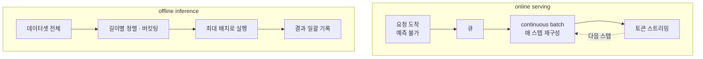
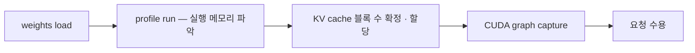
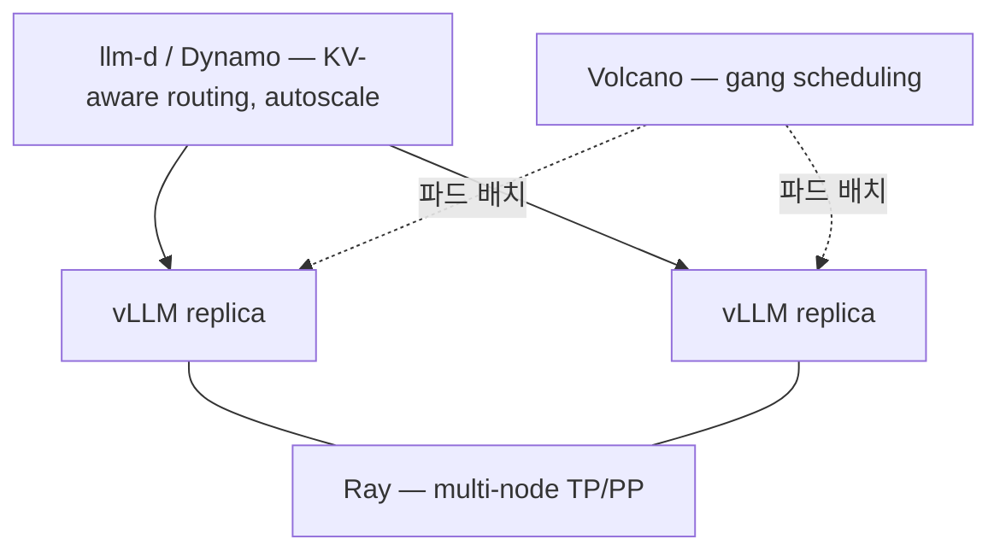
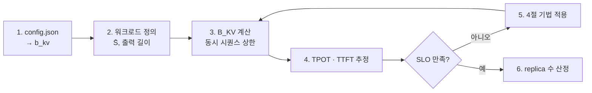

> AI 수요의 증가로, 모던 LLM 서빙 엔진의 구축 사례가 많아지고 있다. 현재 시점에 AR-LLM 의 서빙 환경 구성에 필요한 의사결정과 알려진 고려사항을 개괄적으로 정리해봤다. modality 와 performance technic 등은 제외했다.


## 1. What Actually deploys?

모델을 배포한다는 것은 가중치 파일 하나를 옮기는 작업이 아니다. 아래 다섯 가지가 모두 있어야 학습 때와 같은 출력이 나온다.

| 구성 | 파일 | 빠졌을 때 생기는 일 |
|---|---|---|
| 가중치 | `*.safetensors` | 모델을 실행할 수 없다 |
| 아키텍처 정의 | `config.json` | 가중치를 어떤 그래프에 올릴지 알 수 없다 |
| 토크나이저 | `tokenizer.json`, `tokenizer_config.json` | 같은 문장이 다른 토큰열로 변환된다 |
| 대화 형식 | chat template | 학습 때와 다른 형식의 프롬프트가 모델에 들어간다 |
| 실행 코드 | 런타임 + 커널 | 같은 가중치로도 처리량이 수십 배 차이 난다 |

```text
meta-llama/Llama-3.1-8B-Instruct/
├── config.json                  # 아키텍처 — 3절 계산의 입력
├── generation_config.json       # 샘플링 기본값
├── model-0000{1..4}-of-00004.safetensors   # 가중치 16.1 GB
├── model.safetensors.index.json # 텐서와 파일의 대응표
├── tokenizer.json
└── tokenizer_config.json        # chat template 포함
```

서빙 관점에서 가장 중요한 파일은 `config.json` 이다. 모델을 띄우기 전에 이 파일만으로 GPU 몇 장이 필요한지, 동시에 몇 개의 요청을 받을 수 있는지를 계산할 수 있다.

```json
{
  "num_hidden_layers": 32,
  "num_attention_heads": 32,
  "num_key_value_heads": 8,
  "head_dim": 128,
  "torch_dtype": "bfloat16"
}
```

| 필드 | 서빙에서 결정하는 값 |
|---|---|
| `num_hidden_layers` | KV cache 크기가 이 값에 비례한다 |
| `num_key_value_heads` | `num_attention_heads` 보다 작으면 GQA 다. 두 값의 비율만큼 KV cache 가 줄어든다 |
| `head_dim` | KV cache 크기가 이 값에 비례한다 |
| `torch_dtype` | 가중치 메모리를 결정한다. bf16 이면 파라미터 수 × 2 바이트 |

위 모델은 attention head 32개에 KV head 8개이므로 GQA 4:1 이다. MHA 였다면 KV cache 가 4배 필요했다.

가중치 메모리는 파라미터 수에 상수를 곱하면 끝난다. KV cache 는 여기에 동시 요청 수와 문맥 길이가 추가로 곱해진다. 서빙에서 메모리 계산이 까다로워지는 이유가 이 차이다.

## 2. 서빙 엔진의 주요 수행 기능과 목적

### 2.1 target device

같은 모델이라도 어디에 배치하느냐에 따라 최적화 대상이 달라진다.

| 방식 | 제약 | 최적화 대상 | 예 |
|---|---|---|---|
| on-device | 메모리·전력·발열 | 모델 크기, 양자화 | llama.cpp, CoreML |
| single-model | GPU 메모리 | latency, throughput | vLLM 단일 replica |
| multi-model | 격리, 모델 전환 비용 | GPU 점유율, cold start | LoRA 멀티 어댑터 |
| platform | 운영 복잡도 | 라우팅, 오토스케일 | KServe, llm-d, Ray Serve |

이 글은 single-model 부터 platform 까지를 다룬다.

### 2.2 Online serving vs Offline inference

온라인 추론과 오프라인 추론은 같은 엔진과 같은 모델을 쓰지만, 워크로드의 사용에 따른 고려사항에 차이가 있다.
Request 의 형태에 따라 아래와 같이 구분될 수 있다.



온라인 추론에서는 배치를 미리 구성할 수 없다. 지금 GPU 에 어떤 요청을 태울지 정하는 시점에도 다음 요청이 언제 도착할지 모르기 때문이다. 따라서 매 스텝마다 배치를 다시 구성해야 하고(4.1), 도착률이 처리율을 넘으면 큐가 쌓여 p99 지연이 무너진다.

오프라인 추론은 전체 입력을 알고 시작한다. 길이가 비슷한 요청끼리 묶어 패딩 낭비를 없앨 수 있고, 지켜야 할 지연 목표가 없으므로 배치 크기를 메모리 한계까지 키울 수 있다.

| | online | offline (batch) |
|---|---|---|
| 대표 워크로드 | 챗봇, 코드 어시스턴트, API | 임베딩 생성, 라벨링, 평가셋 추론, 문서 일괄 요약 |
| 목적함수 | latency SLO (TTFT, TPOT) | throughput, 1M 토큰당 비용 |
| 도착 패턴 | 확률적. 피크와 저점이 있다 | 결정적. 전량을 알고 시작한다 |
| 배치 구성 | 도착 순 continuous batching | 길이 정렬 후 최대 배치 |
| 스트리밍 | 필요하다. 체감 속도가 TTFT 로 결정된다 | 필요 없다 |
| 배치 크기의 상한 | SLO | 메모리 | 
| 실패 모드 | 큐 대기 폭증, p99 붕괴 | OOM |
| 스케일 기준 | 피크 트래픽 | 마감 시각 |

3절 이후는 온라인 추론을 기준으로 서술한다. 다만 4절의 최적화 기법은 오프라인 추론에서 효과가 더 크게 나타난다. 배치 크기를 SLO 가 아니라 메모리가 허용하는 만큼 키울 수 있기 때문이다.

### 2.3 기동 lifecycle — Startup

LLM 서빙은 기동 단계에서 일반 모델 배포와 갈라진다. 기동이 끝나는 시점에 그 replica 가 처리할 수 있는 동시 요청 수가 확정되기 때문이다.



순서에 이유가 있다. 엔진은 더미 forward 를 한 번 실행해 활성화와 실행 버퍼가 얼마나 필요한지 파악한 뒤, 남은 메모리 전부를 KV cache 로 미리 할당한다. CUDA graph 는 그 다음에 capture 한다. 요청마다 KV 메모리를 할당하는 방식이 아니라 기동 시점에 전량을 확보하는 방식이다.

따라서 동시 처리 가능한 요청 수는 트래픽이 아니라 기동 시점의 메모리 계산으로 결정된다. rolling update 가 분 단위로 걸리는 이유도 여기 있다. 가중치 로드, profile run, graph capture 를 매번 다시 수행해야 하고 그동안 prefix cache 는 비어 있다.

## 3. AR 생성이 만드는 세 가지 병목 — Three Bottlenecks

### 3.1 재계산 — Recomputation

autoregressive 생성은 토큰을 하나 뽑을 때마다 attention 을 다시 계산한다. attention 은 현재 토큰의 Query 를 과거 전체 토큰의 Key, Value 와 곱하는 연산이므로, 캐시가 없으면 매 스텝 과거 전체를 다시 계산해야 한다. $S$ 개 토큰을 생성하는 데 드는 attention 연산이 $O(S^2)$ 로 늘어난다.

KV cache 는 이 재계산을 없앤다. 각 레이어에서 계산한 Key, Value 텐서를 GPU 메모리에 보관해두고, 다음 스텝에서는 새 토큰 하나의 K, V 만 계산해 뒤에 이어 붙인다. 스텝당 attention 연산이 $O(S)$ 로 줄고, 토큰당 생성 시간이 문맥 길이와 무관하게 거의 일정해진다.


*출처: NVIDIA, [Mastering LLM Techniques: Inference Optimization](https://developer.nvidia.com/ko-kr/blog/mastering-llm-techniques-inference-optimization/)*

이 최적화는 연산을 메모리로 바꾼 것이다. 그 대가로 나머지 두 병목이 생긴다.

### 3.2 KV cache 메모리 — The Concurrency Ceiling

KV cache 는 레이어마다 Key 와 Value 를 각각 보관한다. 토큰 하나가 차지하는 바이트 수는 다음과 같다.

$$b_{kv} = 2\,L\,H_{kv}\,d_h\,p_{kv}\ \ [\text{B/token}]$$

앞의 2 는 Key 와 Value 두 벌을 의미한다. $L$ 은 레이어 수, $H_{kv}$ 는 KV head 수, $d_h$ 는 head 차원, $p_{kv}$ 는 dtype 바이트 수다. 1절의 `config.json` 값을 그대로 넣으면 된다.

| 모델 | attention | $L$ | $H_{kv}$ | $b_{kv}$ (fp16) |
|---|---|---|---|---|
| Llama-2-7B | MHA | 32 | 32 | 512 KiB/token |
| Llama-2-13B | MHA | 40 | 40 | 800 KiB/token |
| Llama-3.1-8B | GQA 4:1 | 32 | 8 | 128 KiB/token |
| Llama-3.1-70B | GQA 8:1 | 80 | 8 | 320 KiB/token |
| DeepSeek-V3 | MLA (latent 512 + rope 64) | 61 | — | 약 69 KiB/token |

KV cache 크기는 파라미터 수가 아니라 레이어 수와 KV head 수로 정해진다. 그래서 671B 파라미터인 DeepSeek-V3 가 7B 파라미터인 Llama-2-7B 보다 토큰당 캐시를 적게 쓴다.

토큰당 크기는 작아 보이지만 곱해지는 항이 두 개 더 있다.

$$M_{kv}^{total} = b_{kv} \times \bar S \times B$$

문맥 길이 $\bar S$ 와 동시 요청 수 $B$ 가 곱해지므로 캐시는 빠르게 커진다. Llama-2-7B (fp16, 4096 토큰) 기준으로 보면 다음과 같다.

| 배치 크기 | KV cache | 가중치 | 합계 |
|---|---|---|---|
| 1 | 2 GB | 14 GB | 16 GB |
| 4 | 8 GB | 14 GB | 22 GB |
| 8 | 16 GB | 14 GB | 30 GB |

배치 8 이면 KV cache 가 가중치보다 커진다. 학습에는 존재하지 않던 항목이 서빙에서 메모리의 절반 이상을 차지한다. A100 40GB 한 장으로는 배치를 8 이상 키울 수 없다는 뜻이기도 하다.

곱해지는 항이 셋이므로 줄일 수 있는 축도 셋이다. 다만 하나는 줄이면 안 된다.

| 축 | 줄이는 방법 | 설명 |
|---|---|---|
| 토큰당 바이트 $b_{kv}$ | MQA / GQA / MLA, KV quantization | 4.3, 4.4 |
| 문맥 길이 $\bar S$ | sliding window attention, prefix 재사용 | SWA 는 최근 $W$ 토큰만 남겨 캐시가 문맥에 비례해 자라는 것을 막는다 (4.3) |
| 동시 요청 수 $B$ | 없음 | $B$ 를 줄이면 처리량이 줄어든다. 나머지 둘을 깎는 목적이 $B$ 를 키우는 것이다 |

엔진이 확보한 KV 메모리를 요청 하나가 쓰는 양으로 나누면 동시 처리 가능한 시퀀스 수가 나온다.

$$B_{KV} = \left\lfloor \frac{M_{gpu}u - M_w - M_{act}}{b_{kv}\,\bar S} \right\rfloor$$

$M_{gpu}u$ 는 엔진에 허용된 GPU 메모리, $M_w$ 는 가중치, $M_{act}$ 는 활성화와 실행 버퍼다. RTX 3090 24GB 에 Llama-3.1-8B fp16 을 올리고 프롬프트 1024 + 출력 256 워크로드를 가정하면 다음과 같다.

```text
M_w     = 8.03e9 × 2 B                              = 15.0 GiB
M_act   = 실행 메모리 (logits, CUDA graph 등) 가정  ≈  2.0 GiB
M_kv    = 24 × 0.9 - 15.0 - 2.0                     =  4.6 GiB
seq 1개 = 1280 토큰 × 128 KiB                       = 0.156 GiB
B_KV    = 4.6 / 0.156                               = 29
```

동시에 29개다. GQA 를 쓰는 8B 모델을 24GB 카드에 올렸을 때의 값이다. 남은 헤드룸이 4.6 GiB 뿐이므로 $M_{act}$ 추정이 1 GiB 만 어긋나도 29 에서 23 으로 떨어진다.

### 3.3 Prefill / Decode — Two Phases, Two Bottlenecks

요청 하나를 처리하는 동안 성격이 다른 두 단계가 순서대로 실행된다. 같은 모델, 같은 GPU 인데 병목 지점이 서로 다르다.

**prefill 단계**는 입력 프롬프트 전체를 한 번에 처리해 K, V 텐서를 계산한다. 모든 입력 토큰이 이미 정해져 있으므로 토큰들을 병렬로 처리할 수 있고, 연산이 행렬 × 행렬 형태가 된다. GPU 연산 유닛이 충분히 채워지므로 **연산량이 병목**이 된다. 이 단계의 소요 시간이 TTFT 를 결정한다.

**decode 단계**는 토큰을 하나씩 순차적으로 생성한다. 스텝마다 새 토큰 하나만 처리하므로 연산이 행렬 × 벡터 형태가 된다. 문제는 이 한 토큰을 계산하기 위해 모델 가중치 전체를 GPU 메모리에서 읽어와야 한다는 점이다. 8B 모델 fp16 이면 매 스텝 15 GiB 를 읽는다. 연산량은 토큰 하나분인데 읽는 양은 그대로이므로 GPU 는 계산이 아니라 데이터 도착을 기다리는 데 시간을 쓴다. **메모리 대역폭이 병목**이고, 이 단계가 TPOT 를 결정한다.

| | prefill | decode |
|---|---|---|
| 처리 단위 | 프롬프트 전체 | 토큰 1개 × 배치 |
| 연산 형태 | 행렬 × 행렬 | 행렬 × 벡터 |
| 병목 | 연산량 (compute-bound) | 메모리 대역폭 (memory-bound) |
| 결정하는 지표 | TTFT | TPOT |
| 개선 방향 | 청크 분할, 커널 효율 | 배치 키우기, 읽는 바이트 줄이기 |

decode 가 메모리 대역폭에 묶여 있다는 사실에서 배치의 중요성이 나온다. 가중치 15 GiB 를 한 번 읽는 동안 요청 29개를 함께 처리하면 요청당 읽기 비용이 1/29 로 줄어든다. decode 효율은 사실상 배치 크기로 결정된다.

그런데 배치를 키우려면 KV cache 메모리가 있어야 한다(3.2). 3090 에서 8B 모델의 배치가 29 에서 막힌다는 것은, KV 메모리를 확보하지 않는 한 decode 효율을 더 올릴 방법이 없다는 뜻이다. 3.2 의 메모리 제약이 3.3 의 처리량 제약으로 그대로 이어진다.

이 워크로드의 대략적인 값은 TPOT 26 ms (시퀀스당 38 tok/s, 전체 1,110 tok/s), TTFT 0.39 s 다.

## 4. 최적화 기법 — Optimization Techniques

3절의 병목에 각 기법을 대응시키면 다음과 같다. 효과는 앞의 3090 / 8B / 1280 토큰 워크로드 기준이다.

| 기법 | 해결하는 병목 | 효과 |
|---|---|---|
| Continuous Batching | 슬롯 유휴 (3.3) | 유효 점유율 43.5% → 100% 근처 |
| PagedAttention | 예약 낭비 (3.2) | 메모리 낭비 60~80% → 4% 미만 |
| GQA / MQA / MLA | $b_{kv}$ (3.2) | MHA 512 → GQA 128 KiB/token |
| Sliding Window Attention | $\bar S$ (3.2) | 문맥이 길어져도 캐시가 $W$ 에서 멈춘다 |
| KV quantization (fp8) | $b_{kv}$ (3.2) | $B_{KV}$ 29 → 58 |
| Weight quantization (W4) | $M_w$ (3.2) | $B_{KV}$ 29 → 98 |
| Tensor Parallel (N=2) | $M_{kv}$, 대역폭 (3.2, 3.3) | $B_{KV}$ 29 → 155, 처리량 5.3배 |
| Speculative Decoding | 가중치 읽기 횟수 (3.3) | 읽기 1회당 토큰 1개 → 최대 4개 |

여러 기법을 함께 적용했을 때의 결과는 공개 벤치마크로 확인할 수 있다. 아래는 같은 GPU 와 모델에서 배치 전략만 바꾼 결과다.

| 배치 전략 | 상대 throughput |
|---|---|
| static batching | 1× |
| optimized static (FasterTransformer) | 4× |
| continuous batching | 8× |
| continuous batching + PagedAttention (vLLM) | **23×** |

Anyscale 벤치마크, OPT-13B / A100 40GB, 요청 1,000건 · 입력 512 토큰 기준이다. 23배 중 8배까지가 스케줄링에서 나오고 나머지가 메모리 관리에서 나온다. 커널을 수정하지 않고 얻은 수치라는 점이 중요하다.

### 4.1 Continuous Batching

static batching 은 배치를 구성한 뒤 모든 요청이 끝날 때까지 그 구성을 유지한다. 문제는 요청마다 출력 길이가 다르다는 점이다. 배치 안에서 가장 긴 요청이 끝날 때까지 이미 완료된 요청의 슬롯이 비어 있는 채로 GPU 스텝을 소모한다.

출력 길이가 20 / 500 / 50 / 300 토큰인 요청 4개를 static batch 로 묶으면 500 스텝을 도는 동안 실제로 쓰이는 슬롯은 다음과 같다.

$$\frac{20+500+50+300}{4 \times 500} = 43.5\%$$

continuous batching (TensorRT-LLM 에서는 in-flight batching 이라 부른다) 은 스텝 단위로 배치를 재구성한다. 완료된 시퀀스를 즉시 배치에서 제거하고 대기 중인 요청을 그 자리에 넣는다. 요청이 배치의 시작을 기다릴 필요도 없다.

여기에 한 가지 문제가 남는다. prefill 은 토큰을 수백 개 한 번에 처리하므로 스텝 하나가 길다. 긴 프롬프트가 들어오면 그 스텝 동안 진행 중인 모든 decode 가 멈추고, 다른 사용자의 TPOT 가 튄다. chunked prefill 은 prefill 을 여러 청크로 나눠 decode 스텝 사이에 끼워 넣어 이 지연을 없앤다.

### 4.2 PagedAttention

연속 메모리 할당 방식에서는 요청이 도착할 때 `max_model_len` 만큼의 KV 영역을 미리 잡아야 한다. 시퀀스가 얼마나 길어질지 모르기 때문이다. 실제 출력이 200 토큰이어도 4096 토큰 분량이 예약되고, 그 사이 공간은 다른 요청이 쓸 수 없다. vLLM 논문은 기존 시스템이 이런 과다 예약과 단편화로 KV 메모리의 60~80% 를 낭비한다고 보고했다.

PagedAttention 은 OS 의 가상 메모리 페이징을 KV cache 에 적용한다. 캐시를 고정 크기 블록으로 나누고, 블록을 물리적으로 연속하지 않은 위치에 배치한 뒤 블록 테이블로 논리 위치와 물리 위치를 매핑한다. 시퀀스가 자라면 블록을 하나씩 추가한다.

블록 크기가 16 이면 Llama-3.1-8B 기준으로 한 블록이 2 MiB 이고, 시퀀스당 낭비는 마지막 블록의 빈 자리, 즉 최대 15 토큰 = 1.9 MiB 로 제한된다. 낭비율이 4% 미만으로 떨어지고 그만큼이 $B_{KV}$ 로 돌아온다.

블록 단위 관리는 재사용도 가능하게 만든다. 같은 prefix 를 쓰는 요청들이 블록을 참조로 공유하면 prefill 을 건너뛸 수 있다.

| 재사용 범위 | 기법 | 얻는 것 |
|---|---|---|
| 요청 간 | prefix caching, radix tree | 공유 prefix 만큼 TTFT 감소 |
| 메모리 밖 | CPU / storage offload | KV 용량 확장, 대신 전송 지연 추가 |
| replica 간 | KV-aware routing, P/D disaggregation | 캐시를 가진 replica 로 요청을 보낸다 |

system prompt 나 few-shot 예시가 긴 워크로드에서는 prefix cache hit rate 가 처리량을 크게 좌우한다. 6절 모니터링에 이 지표를 포함해야 하는 이유다.

### 4.3 Attention 변형 — MHA / MQA / GQA / MLA / SWA

$b_{kv}$ 를 줄이는 방법은 attention 구조 자체를 바꾸는 것이다. 이 기법들은 학습 시점에 결정되므로 서빙에서는 선택이 아니라 모델 선정의 문제가 된다.

**MHA (Multi-Head Attention)** 는 Query, Key, Value 를 head 수만큼 각각 만든다. head 가 32개면 K 와 V 도 32벌이다. KV cache 가 가장 크다.

**MQA (Multi-Query Attention)** 는 Query 만 head 수만큼 두고 Key 와 Value 는 한 벌만 둔다. 모든 Query head 가 같은 K, V 를 공유한다. KV cache 가 head 수만큼 줄어들고 decode 에서 읽을 바이트도 그만큼 준다. 대신 표현력이 떨어져 품질 저하가 생길 수 있다.

**GQA (Grouped-Query Attention)** 는 그 중간이다. Query head 를 그룹으로 묶고 그룹당 K, V 한 벌씩을 둔다. Query head 32개에 KV head 8개면 4개씩 한 벌을 공유하므로 KV cache 가 1/4 이 된다. 품질 손실이 MQA 보다 작아 최근 모델 대부분이 이 방식을 쓴다.

**MLA (Multi-head Latent Attention)** 는 K, V 를 그대로 저장하지 않고 저차원 latent 로 압축해 저장한 뒤 사용할 때 복원한다. DeepSeek-V2/V3 가 쓰는 방식이고, 앞의 표에서 봤듯 토큰당 캐시가 GQA 보다도 작다.

**SWA (Sliding Window Attention)** 는 다른 축을 건드린다. 위 셋이 토큰당 바이트를 줄인다면, SWA 는 저장하는 토큰 수를 제한한다. 각 토큰이 최근 $W$ 개 토큰만 참조하도록 하면 그보다 오래된 K, V 는 캐시에서 버릴 수 있다. Mistral-7B 는 $W$ = 4096 이고 문맥 8192 를 지원하므로 캐시가 절반이 된다. 문맥 길이가 늘어나도 캐시가 $W$ 에서 멈추는 것이 핵심이다. 윈도우 밖 정보는 레이어를 거치며 간접적으로 전달된다.

| 방식 | KV head 수 | Llama-2-7B 기준 $b_{kv}$ | 특징 |
|---|---|---|---|
| MHA | Query head 와 동일 | 512 KiB/token | 품질 기준선 |
| GQA (4:1) | Query head / 4 | 128 KiB/token | 품질 손실 작음. 현재 표준 |
| MQA | 1 | 16 KiB/token | 가장 작지만 품질 저하 |
| MLA | latent 압축 | 약 69 KiB/token (V3) | 압축·복원 연산이 추가된다 |
| SWA | 변화 없음 | 문맥이 $W$ 를 넘으면 고정 | $\bar S$ 를 캡한다 |

### 4.4 Quantization

양자화는 숫자를 더 적은 비트로 표현해 메모리와 대역폭을 줄인다. 서빙에서 줄일 수 있는 대상이 둘이다.

**가중치 양자화**는 $M_w$ 를 줄인다. 가중치는 추론 중에 바뀌지 않으므로 오프라인에서 한 번 변환해두면 된다. AWQ, GPTQ 가 대표적이고 fp16 대비 4비트면 메모리가 1/4 이 된다. 줄어든 만큼이 그대로 KV cache 로 넘어간다.

**KV cache 양자화**는 $b_{kv}$ 를 줄인다. fp16 을 fp8 로 바꾸면 토큰당 바이트가 절반이 된다. 다만 KV 는 추론 중에 생성되는 값이라 이상치 처리가 가중치보다 까다롭다.

| 설정 | $M_w$ | $b_{kv}$ | $M_{kv}$ | $B_{KV}$ |
|---|---|---|---|---|
| fp16 | 15.0 GiB | 128 KiB | 4.6 | 29 |
| `--kv-cache-dtype fp8` | 15.0 GiB | 64 KiB | 4.6 | 58 |
| W4 (AWQ/GPTQ) | 4.2 GiB | 128 KiB | 15.4 | 98 |
| W4 + KV fp8 | 4.2 GiB | 64 KiB | 15.4 | 197 |

29 에서 197 로 6.8배다.

주의할 점은 하드웨어 지원 여부다. RTX 3090 은 Ampere 세대라 FP8 연산 유닛이 없어서, W4 와 KV fp8 모두 읽은 뒤 fp16 으로 복원해 계산한다. 연산 속도는 전혀 개선되지 않는다. 그럼에도 효과가 있는 것은 decode 가 메모리 대역폭에 묶여 있기 때문이다(3.3). 읽는 바이트가 줄면 스텝 시간이 줄어든다. 저정밀도가 서빙에서 효과를 내는 이유가 이 비대칭이다.

같은 계열의 기법으로 sparsity 와 distillation 이 있다. 전자는 0에 가까운 가중치를 0으로 만들어 압축하고, 후자는 큰 모델의 지식을 작은 모델로 옮긴다. 둘 다 $M_w$ 를 줄이는 방향이지만 정확도 손실을 감수해야 한다.

### 4.5 Speculative Decoding

3.3 에서 decode 효율이 배치 크기로 결정된다고 했는데, 배치를 키우려면 KV 메모리가 필요하다. 메모리가 없으면 여기서 막힌다.

speculative decoding 은 다른 방향으로 접근한다. 작고 빠른 draft 모델이 토큰 $\gamma$ 개를 먼저 생성하고, 본 모델이 그 $\gamma$ 개를 한 번의 forward 로 검증한다. 검증은 병렬 처리가 가능하므로 prefill 과 비슷한 연산 형태가 된다. 결과적으로 **가중치를 한 번 읽고 토큰 $\gamma{+}1$ 개까지 확정**할 수 있다.

draft 가 틀린 토큰은 버리고 그 지점부터 다시 생성하므로 실제 이득은 수용률에 비례한다. draft 를 만드는 방법은 별도의 작은 모델을 쓰거나, 본 모델에 예측 헤드를 여러 개 붙여 미세조정하는 방식이 있다.

KV 메모리를 추가로 쓰지 않고 스텝당 처리량을 올릴 수 있어서, 메모리에 막힌 상황에서 쓸 수 있는 몇 안 되는 방법이다.

### 4.6 병렬화 — Tensor / Pipeline Parallelism

모델이 GPU 한 장에 들어가지 않거나, 들어가더라도 KV cache 공간이 부족할 때 GPU 를 여러 장 쓴다. 나누는 방향이 둘이다.

**Pipeline Parallelism (PP)** 은 모델을 레이어 단위로 세로 분할한다. 4-way 면 각 GPU 가 전체 레이어의 1/4 을 맡고 가중치 메모리도 1/4 이 된다. 문제는 앞 GPU 가 계산을 끝내야 뒤 GPU 가 시작할 수 있어서 유휴 구간(pipeline bubble)이 생긴다는 점이다. 입력을 마이크로배치로 쪼개면 완화되지만 완전히 없앨 수는 없다.

**Tensor Parallelism (TP)** 은 레이어 내부를 가로 분할한다. MLP 의 가중치 행렬을 열/행 방향으로 쪼개 각 GPU 가 부분 결과를 계산하고, attention 은 head 단위로 나눈다. 각 GPU 가 동시에 일하므로 bubble 이 없는 대신, 레이어마다 결과를 합치는 all-reduce 통신이 필요하다.

서빙에서 TP 를 먼저 쓰는 이유는 KV 용량이 GPU 수보다 빠르게 늘기 때문이다. 가중치는 GPU 수로 나뉘는데 GPU 당 여유 메모리는 GPU 수만큼 곱해진다.

```text
TP=1:  M_kv = 21.6 - 15.0 - 2.0        =  4.6 GiB  → B_KV =  29  → 1,110 tok/s
TP=2:  M_kv = 2 × (21.6 - 7.5 - 2.0)   = 24.2 GiB  → B_KV = 155  → 5,870 tok/s
                                                       5.3x        5.3x
```

GPU 를 2배 쓰는데 처리량이 5.3배가 된다. 메모리에 막혀 있던 상황이라 배치를 크게 늘릴 수 있어서다.

무한정 늘릴 수 없는 이유는 둘이다. 첫째, 레이어마다 all-reduce 가 붙으므로 GPU 수가 늘면 통신 비용이 먼저 지배한다. 둘째, attention 은 head 단위로 나뉘는데 GQA 모델은 KV head 가 8개뿐이다. TP 를 8보다 크게 잡으면 KV head 를 복제해야 하고, 그 순간 KV 메모리 이득이 사라진다.

### 4.7 FlashAttention

FlashAttention 은 attention 연산을 GPU 메모리 계층에 맞게 재배치한다. attention 중간 결과인 $S \times S$ 행렬을 HBM 에 쓰지 않고, 타일 단위로 잘라 SRAM 안에서 계산을 끝낸다. 수학적으로는 기존 attention 과 동일한 결과가 나오므로 모델을 수정할 필요가 없다.

효과가 나는 곳은 prefill 이다. 프롬프트가 길수록 중간 행렬이 커지므로 메모리 사용량과 TTFT 가 함께 줄어든다.

decode 는 사정이 다르다. 토큰 하나를 처리할 때 중간 행렬이 $1 \times S$ 라 애초에 크지 않다. decode 쪽 개선은 FlashDecoding 이 담당하는데, KV 를 여러 조각으로 나눠 병렬로 읽어 배치가 작을 때의 지연을 줄이는 방식이다.

두 기법 모두 커널 레이어 최적화라 엔진이 하드웨어에 맞춰 자동으로 선택한다. 서빙 설정에서 직접 고를 일은 거의 없다.

## 5. 지표와 SLO — Metrics and SLOs

| 지표 | 정의 | 지배 단계 |
|---|---|---|
| TTFT | 요청 도착부터 첫 토큰까지 | prefill |
| TPOT (ITL) | 토큰과 토큰 사이 간격 | decode |
| E2E latency | 요청 도착부터 마지막 토큰까지 | 대체로 decode |
| Throughput | 초당 토큰 수 또는 초당 요청 수 | — |
| Goodput | SLO 를 만족한 요청만 센 throughput | — |

TPOT 의 목표값은 사람이 읽는 속도에서 나온다. 영어 기준으로 단어 하나가 대략 1.5 토큰이므로, 분당 단어 수(WPM)를 초당 토큰 수로 환산하면 필요한 TPOT 가 나온다.

| 독자 | WPM | 필요 tok/s | TPOT |
|---|---|---|---|
| 평균 | 250 | 6.3 | 160 ms |
| 빠름 | 400 | 10.0 | 100 ms |
| 초고속 | 700 | 17.5 | 57 ms |

TPOT 50~100 ms 가 관행처럼 쓰이는 근거가 이 표다. 이보다 빨라져도 사람이 읽지 못하므로, 남는 대역폭은 배치를 키워 throughput 으로 돌리는 편이 낫다.

지표를 여러 개 두는 이유는 셋이다.

- 사용자가 체감하는 시점이 둘로 나뉜다. 첫 글자가 뜨기까지와 그 뒤 읽는 속도다. 병목도 3.3 처럼 서로 다르므로 하나의 지연 지표로 묶을 수 없다.
- 출력 길이를 미리 알 수 없어 요청 비용이 값이 아니라 분포가 된다. 평균으로 SLO 를 걸면 절반이 위반이어도 통과한다. p95 나 p99 로 걸어야 한다.
- throughput 만 올리면 SLO 를 깨면서 숫자가 오른다. 배치를 키우면 초당 토큰 수는 늘지만 사용자별 TPOT 는 나빠진다. goodput 은 이 문제를 피하려고 SLO 를 만족한 요청만 세는 지표다.

streaming 과 batching 은 서로 다른 지표를 건드린다.

| | 개선하는 것 | 개선하지 않는 것 |
|---|---|---|
| streaming | 체감 시작 시점. TTFT 가 SLO 대상이 된다 | 총 처리량, 전체 생성 시간 |
| batching | throughput | 사용자별 TPOT. 오히려 나빠진다 |

도착률을 산정할 때 주의할 점이 하나 있다. `동시 처리 수 ÷ E2E latency` 로 나온 값은 이용률이 1인 포화점이다. 이 지점에서는 큐 길이가 발산하고 p99 TTFT 를 prefill 시간이 아니라 대기 시간이 지배한다. 운영 목표는 보통 이 값의 70% 로 잡는다.

## 6. 무엇을 모니터링하나 — Observability

GPU util 100% 는 GPU 가 일하고 있다는 뜻이 아니라 커널이 올라와 있다는 뜻이다. decode 는 메모리에서 가중치를 읽는 데 시간을 쓰므로, 연산 유닛이 놀고 있어도 util 은 높게 표시된다.

그래서 두 층을 함께 봐야 한다.

| 층 | 대표 도구 | 확인하는 것 |
|---|---|---|
| 하드웨어 | DCGM exporter | 연산 유닛 가동률, 메모리 대역폭, 메모리 점유, 통신·전력 |
| 엔진 | vLLM `/metrics` | 큐 길이, KV 점유율, preemption, prefix cache hit rate, TTFT/TPOT 분포 |

하드웨어 지표만 보면 "GPU 는 바쁜데 왜 느린가" 에서 진단이 멈춘다. 엔진 지표를 함께 봐야 원인이 갈린다.

| 증상 | 판정 |
|---|---|
| preemption 발생 | KV 상한 초과. 4절의 기법으로 대응 |
| TTFT 상승 + 큐 대기 증가 + KV 점유 포화 | 용량 부족. replica 추가 |
| TTFT 상승 + 큐 대기 증가 + KV 점유 여유 | 스케줄러 또는 라우팅 문제 |
| TPOT 상승 + KV 점유 여유 | 배치가 과도함 |
| prefix cache hit rate 급락 | 캐시가 없는 replica 로 라우팅되는 중 |

preemption 은 특히 중요한 신호다. KV 점유율이 90% 인 것은 정상 동작이지만, preemption 이 발생했다는 것은 이미 실행 중이던 시퀀스를 메모리 부족으로 쫓아내고 나중에 다시 계산하고 있다는 뜻이다.

## 7. 서빙 프레임워크 생태계 — The Serving Stack

### 7.1 엔진 — Engines

엔진은 4절의 기법들을 구현해 제공한다. 엔진 없이 서빙하려면 continuous batching 스케줄러, KV 블록 할당과 회수, chunked prefill, 병렬화 배선, CUDA graph, 샘플링, API, 메트릭을 전부 직접 만들어야 한다.

| 엔진 | 특징 | 적합한 상황 |
|---|---|---|
| vLLM | PagedAttention, 넓은 모델 커버리지, HF 생태계 연동 | 기본 선택지 |
| SGLang | RadixAttention 기반 KV 재사용, 구조화 출력 | prefix 재사용이 많은 워크로드 |
| TensorRT-LLM | 커널 튜닝과 양자화가 강하다. 모델별 엔진 빌드 필요 | NVIDIA GPU 고정, 최대 성능 |
| llama.cpp | CPU 실행과 메모리 절약, GGUF 포맷 | on-device |

NVIDIA 스택에서는 TensorRT-LLM 이 엔진 역할을, Triton Inference Server 가 그 위에서 요청 처리와 배포를 담당한다.

3절의 각 항은 대부분 엔진 플래그 하나에 대응한다.

| 항 | vLLM 플래그 |
|---|---|
| 동시 처리 수 상한 | `--max-num-seqs` |
| prefill/decode 혼합 비율 | `--enable-chunked-prefill`, `--max-num-batched-tokens` |
| $\bar S$ 상한 | `--max-model-len` |
| $\bar S$ 유효값 | `--enable-prefix-caching` |
| GPU 메모리 비율 $u$ | `--gpu-memory-utilization` |
| $b_{kv}$ | `--kv-cache-dtype fp8` |
| $M_w$ | `--quantization awq` / `gptq` |
| GPU 수 | `--tensor-parallel-size`, `--pipeline-parallel-size` |
| draft 길이 $\gamma$ | `--speculative-config` |

### 7.2 그 위의 층 — Above the Engine

vLLM, Ray, Volcano, llm-d 는 서로 대체 관계가 아니라 담당하는 층이 다르다.

| 층 | 하는 일 | 예 |
|---|---|---|
| 엔진 | 단일 replica 실행, 배치, KV 관리 | vLLM, SGLang, TensorRT-LLM |
| 분산 런타임 | 멀티노드 프로세스 배치, TP/PP 배선 | Ray |
| 배치 스케줄러 | gang scheduling, 큐와 쿼터, GPU 할당 | Volcano, Kueue |
| 서빙 오케스트레이션 | KV-aware 라우팅, P/D 분리, 오토스케일 | llm-d, Dynamo, Ray Serve |



상술한 stack 들을 조합하면 대략 위와 같이 service design 을 구성할 수 있다. 이는 절대적인 구조가 아니며 각 소프트웨어의 역할에 따른 구성이다. Volcano 대신 Kueue 를 쓰거나, 단일 노드로 충분하면 Ray 층을 빼거나, 오케스트레이션 없이 엔진만 띄우는 구성도 가능하다.

층을 나누는 이유는 확장 단위가 서로 다르기 때문이다. 라우팅과 API 처리는 CPU 작업이고 엔진은 GPU 작업이라, 부하가 걸리는 쪽이 상황에 따라 달라진다. Ray Serve LLM 은 이를 별개 배포로 두고 각각 독립적으로 스케일하며, ingress : replica = 2 : 1 을 기본 비율로 제안한다. prefill 과 decode 를 분리하는 구성도 같은 방식이다. 두 단계의 병목이 다르므로(3.3) 배포를 나눠 각각 필요한 만큼만 확장한다.

라우팅에서는 prefix cache 를 고려해야 한다. 4.2 의 prefix cache 는 각 엔진 replica 의 GPU 메모리 안에 만들어지므로 replica 마다 내용이 다르다. 같은 system prompt 를 쓰는 요청이 매번 다른 replica 로 가면 캐시가 있어도 재사용되지 않는다. 그래서 오케스트레이션 층이 어떤 replica 가 어떤 prefix 를 들고 있는지 추적해 요청을 그쪽으로 보내는 방식(KV-aware routing)을 쓴다.

Kubernetes 로 배포한다면 이 부분이 Service 설정으로 넘어온다. 기본 로드밸런싱은 요청을 균등 분배하므로 캐시 지역성을 깨뜨린다. 세션 친화성(session affinity)이나 consistent hashing 을 켜서 같은 prefix 의 요청이 같은 Pod 으로 가도록 하거나, 캐시 상태를 아는 별도 라우터를 앞에 두는 선택이 필요할 수 있다. 워크로드에 따라 이득 폭이 달라지므로 hit rate 를 측정해 결정하는 편이 낫다.

## 8. 규모 산정 순서 — Capacity Planning Recipe

앞 절의 내용을 실제 사이징 순서로 다시 정리하면 다음과 같다. 1~3 단계는 `config.json` 과 워크로드 가정만으로 진행할 수 있고, 4단계부터는 하드웨어 사양이 필요하다.



| 단계 | 입력 | 출력 |
|---|---|---|
| 1 | `config.json` (layers, kv_heads, head_dim, dtype) | 토큰당 KV 바이트 $b_{kv}$ |
| 2 | 프롬프트와 출력 길이 분포, prefix 공유 여부 | 유효 $\bar S$ |
| 3 | GPU 메모리, 가중치, 실행 메모리 | 동시 처리 상한 $B_{KV}$ |
| 4 | 메모리 대역폭, 가중치 크기 | TPOT, TTFT 추정치 |
| 5 | 4절 표 | 바뀐 $b_{kv}$ / $M_w$ / $B$ |
| 6 | 피크 도착률, E2E latency | replica 수 |

계산 결과를 크게 흔드는 요인이 넷이다.

- **2단계의 $\bar S$ 추정.** 문맥 길이를 `max_model_len` 으로 잡으면 과대 산정이 되어 GPU 를 필요 이상으로 준비하게 된다. 반대로 평균으로 잡으면 긴 요청이 몰릴 때 preemption 이 발생한다. 길이 분포를 확인해 p90 정도로 잡는 방법을 쓴다.
- **KV cache 재사용 반영 여부.** system prompt 가 공유되면 유효 $\bar S$ 가 그만큼 내려간다(4.2). 이를 계산에 넣지 않으면 필요 용량이 과대 산정된다.
- 값을 잡는 범위는 가능한 극단적인 경우가 좋다고 생각한다. 실제 값은 스케줄러가 그 상한에 얼마나 근접하느냐에 달려 있고, 이는 측정으로 확인해야 한다.
- 어떤 결정이든 중재안이 있다고 생각한다. 다만 조직 내에 LLM 환경이 배포되는 경우, 종종 heavy user 들이 있다. 더구나 AI 를 업무에 응용하기 위해 자원을 사용하는 경우, 더 잠재적인 capa 가 높게 설정하는 것이 실리적이기도 했다.

---

## Reference

- Hands-On LLM Serving and Optimization
- https://arxiv.org/abs/2407.12391
- https://www.usenix.org/system/files/osdi22-yu.pdf
- https://arxiv.org/abs/2309.06180
- https://arxiv.org/abs/2305.13245
- https://arxiv.org/abs/2405.04434
- https://arxiv.org/abs/2310.06825
- https://arxiv.org/abs/2205.14135
- https://arxiv.org/abs/2211.17192
- https://developer.nvidia.com/ko-kr/blog/mastering-llm-techniques-inference-optimization/
- https://www.anyscale.com/blog/continuous-batching-llm-inference
- https://www.omrimallis.com/posts/techniques-for-kv-cache-optimization/
- https://docs.ray.io/en/latest/serve/llm/architecture/overview.html
