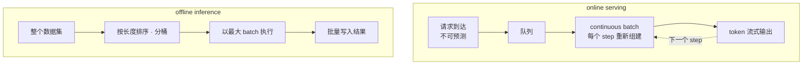
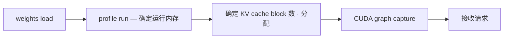
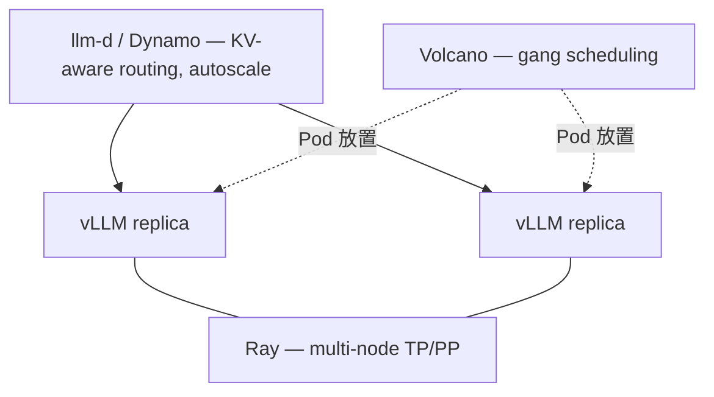
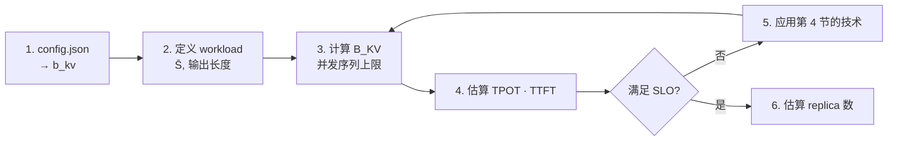

> 随着 AI 需求的增长，构建现代 LLM serving 引擎的案例越来越多。本文概括整理了当前时点构建 AR-LLM serving 环境所需的决策和已知的考量事项。modality 和 performance technic 等内容未包含在内。


## 1. What Actually deploys?

部署模型并不是搬运一个权重文件的工作。下面五项全部具备，才能得到与训练时相同的输出。

| 组成 | 文件 | 缺失时会发生什么 |
|---|---|---|
| 权重 | `*.safetensors` | 模型无法运行 |
| 架构定义 | `config.json` | 无法知道权重应加载到哪个计算图上 |
| Tokenizer | `tokenizer.json`, `tokenizer_config.json` | 同一句话会被转换成不同的 token 序列 |
| 对话格式 | chat template | 进入模型的 prompt 格式与训练时不同 |
| 执行代码 | runtime + kernel | 同样的权重，吞吐量也会相差数十倍 |

```text
meta-llama/Llama-3.1-8B-Instruct/
├── config.json                  # 架构 — 第 3 节计算的输入
├── generation_config.json       # 采样默认值
├── model-0000{1..4}-of-00004.safetensors   # 权重 16.1 GB
├── model.safetensors.index.json # 张量与文件的对应表
├── tokenizer.json
└── tokenizer_config.json        # 包含 chat template
```

从 serving 的角度看，最重要的文件是 `config.json`。在启动模型之前，仅凭这个文件就能算出需要几张 GPU、能同时接收多少个请求。

```json
{
  "num_hidden_layers": 32,
  "num_attention_heads": 32,
  "num_key_value_heads": 8,
  "head_dim": 128,
  "torch_dtype": "bfloat16"
}
```

| 字段 | 在 serving 中决定的值 |
|---|---|
| `num_hidden_layers` | KV cache 大小与该值成正比 |
| `num_key_value_heads` | 小于 `num_attention_heads` 时即为 GQA。KV cache 按两者的比例缩小 |
| `head_dim` | KV cache 大小与该值成正比 |
| `torch_dtype` | 决定权重内存。bf16 时为参数量 × 2 字节 |

上面的模型有 32 个 attention head 和 8 个 KV head，因此是 GQA 4:1。如果是 MHA，KV cache 需要 4 倍。

权重内存只需将参数量乘以一个常数即可得出。KV cache 则还要再乘以并发请求数和上下文长度。serving 中内存计算变得棘手的原因就在于这一差异。

## 2. Serving 引擎的主要功能与目的

### 2.1 target device

即使是同一个模型，部署位置不同，优化对象也不同。

| 方式 | 约束 | 优化对象 | 示例 |
|---|---|---|---|
| on-device | 内存·功耗·发热 | 模型大小、量化 | llama.cpp, CoreML |
| single-model | GPU 内存 | latency, throughput | vLLM 单 replica |
| multi-model | 隔离、模型切换成本 | GPU 占用率、cold start | LoRA 多 adapter |
| platform | 运维复杂度 | 路由、自动扩缩容 | KServe, llm-d, Ray Serve |

本文涵盖从 single-model 到 platform 的范围。

### 2.2 Online serving vs Offline inference

在线推理和离线推理使用相同的引擎和相同的模型，但随 workload 的使用方式不同，考量事项存在差异。
根据 request 的形态，可以按如下方式区分。



在线推理中无法预先组建 batch。因为在决定当前把哪些请求放到 GPU 上的时刻，也不知道下一个请求何时到达。因此每个 step 都必须重新组建 batch（4.1），一旦到达率超过处理率，队列就会堆积，p99 延迟随之崩溃。

离线推理在已知全部输入的前提下开始。可以把长度相近的请求归到一起以消除 padding 浪费，并且没有需要遵守的延迟目标，因此可以把 batch size 增大到内存上限。

| | online | offline (batch) |
|---|---|---|
| 典型 workload | 聊天机器人、代码助手、API | embedding 生成、标注、评测集推理、文档批量摘要 |
| 目标函数 | latency SLO (TTFT, TPOT) | throughput、每 1M token 的成本 |
| 到达模式 | 随机的。有峰值和低谷 | 确定的。开始前已知全部数据量 |
| batch 组建 | 按到达顺序 continuous batching | 按长度排序后取最大 batch |
| streaming | 需要。体感速度由 TTFT 决定 | 不需要 |
| batch size 的上限 | SLO | 内存 | 
| 失败模式 | 队列等待暴增、p99 崩溃 | OOM |
| 扩容基准 | 峰值流量 | 截止时间 |

第 3 节之后以在线推理为基准进行叙述。不过第 4 节的优化技术在离线推理中效果更明显。因为 batch size 可以增大到内存允许的程度，而不是 SLO 允许的程度。

### 2.3 启动 lifecycle — Startup

LLM serving 在启动阶段就与一般的模型部署不同。因为在启动结束的时刻，该 replica 能处理的并发请求数就已确定。



这个顺序是有原因的。引擎先执行一次 dummy forward，确定激活值和执行 buffer 需要多少内存，然后把剩余内存全部预先分配给 KV cache。CUDA graph 在此之后再 capture。它不是为每个请求分配 KV 内存，而是在启动时一次性确保全部内存。

因此，可并发处理的请求数不是由流量决定，而是由启动时的内存计算决定。rolling update 需要以分钟计的时间，原因也在这里。权重加载、profile run、graph capture 每次都要重新执行，而在此期间 prefix cache 是空的。

## 3. AR 生成带来的三个瓶颈 — Three Bottlenecks

### 3.1 重复计算 — Recomputation

autoregressive 生成每产出一个 token 都要重新计算 attention。attention 是将当前 token 的 Query 与过去全部 token 的 Key、Value 相乘的运算，因此没有缓存时，每个 step 都要把过去的全部内容重新计算一遍。生成 $S$ 个 token 所需的 attention 运算量增长为 $O(S^2)$。

KV cache 消除了这种重复计算。它把各层计算出的 Key、Value 张量保存在 GPU 内存中，下一个 step 只计算一个新 token 的 K、V 并追加到末尾。每个 step 的 attention 运算降为 $O(S)$，每个 token 的生成时间几乎恒定，与上下文长度无关。


*来源：NVIDIA, [Mastering LLM Techniques: Inference Optimization](https://developer.nvidia.com/ko-kr/blog/mastering-llm-techniques-inference-optimization/)*

这项优化是把计算换成了内存。作为代价，产生了其余两个瓶颈。

### 3.2 KV cache 内存 — The Concurrency Ceiling

KV cache 在每一层分别保存 Key 和 Value。一个 token 占用的字节数如下。

$$b_{kv} = 2\,L\,H_{kv}\,d_h\,p_{kv}\ \ [\text{B/token}]$$

前面的 2 表示 Key 和 Value 两份。$L$ 是层数，$H_{kv}$ 是 KV head 数，$d_h$ 是 head 维度，$p_{kv}$ 是 dtype 的字节数。直接代入第 1 节 `config.json` 的值即可。

| 模型 | attention | $L$ | $H_{kv}$ | $b_{kv}$ (fp16) |
|---|---|---|---|---|
| Llama-2-7B | MHA | 32 | 32 | 512 KiB/token |
| Llama-2-13B | MHA | 40 | 40 | 800 KiB/token |
| Llama-3.1-8B | GQA 4:1 | 32 | 8 | 128 KiB/token |
| Llama-3.1-70B | GQA 8:1 | 80 | 8 | 320 KiB/token |
| DeepSeek-V3 | MLA (latent 512 + rope 64) | 61 | — | 约 69 KiB/token |

KV cache 的大小不是由参数量决定，而是由层数和 KV head 数决定。所以 671B 参数的 DeepSeek-V3 每个 token 使用的缓存比 7B 参数的 Llama-2-7B 还少。

每个 token 的大小看起来很小，但还有两个相乘的项。

$$M_{kv}^{total} = b_{kv} \times \bar S \times B$$

由于要乘以上下文长度 $\bar S$ 和并发请求数 $B$，缓存增长得很快。以 Llama-2-7B（fp16，4096 token）为基准，结果如下。

| batch size | KV cache | 权重 | 合计 |
|---|---|---|---|
| 1 | 2 GB | 14 GB | 16 GB |
| 4 | 8 GB | 14 GB | 22 GB |
| 8 | 16 GB | 14 GB | 30 GB |

batch 为 8 时，KV cache 比权重还大。训练时不存在的项目在 serving 中占据了一半以上的内存。这也意味着单张 A100 40GB 无法把 batch 增大到 8 以上。

相乘的项有三个，所以可以缩减的轴也有三个。不过其中一个不能缩减。

| 轴 | 缩减方法 | 说明 |
|---|---|---|
| 每 token 字节数 $b_{kv}$ | MQA / GQA / MLA, KV quantization | 4.3, 4.4 |
| 上下文长度 $\bar S$ | sliding window attention、prefix 复用 | SWA 只保留最近 $W$ 个 token，阻止缓存随上下文成比例增长 (4.3) |
| 并发请求数 $B$ | 无 | 减小 $B$ 会降低吞吐量。削减另外两项的目的就是增大 $B$ |

用引擎确保的 KV 内存除以单个请求使用的量，就得到可并发处理的序列数。

$$B_{KV} = \left\lfloor \frac{M_{gpu}u - M_w - M_{act}}{b_{kv}\,\bar S} \right\rfloor$$

$M_{gpu}u$ 是允许引擎使用的 GPU 内存，$M_w$ 是权重，$M_{act}$ 是激活值和执行 buffer。假设在 RTX 3090 24GB 上加载 Llama-3.1-8B fp16，workload 为 prompt 1024 + 输出 256，结果如下。

```text
M_w     = 8.03e9 × 2 B                              = 15.0 GiB
M_act   = 运行内存 (logits, CUDA graph 等) 假设    ≈  2.0 GiB
M_kv    = 24 × 0.9 - 15.0 - 2.0                     =  4.6 GiB
seq 1个 = 1280 token × 128 KiB                      = 0.156 GiB
B_KV    = 4.6 / 0.156                               = 29
```

并发 29 个。这是把使用 GQA 的 8B 模型放到 24GB 显卡上时的值。剩余 headroom 只有 4.6 GiB，所以 $M_{act}$ 的估计只要偏差 1 GiB，就会从 29 降到 23。

### 3.3 Prefill / Decode — Two Phases, Two Bottlenecks

处理一个请求的过程中，两个性质不同的阶段依次执行。模型相同、GPU 相同，但瓶颈位置各不相同。

**prefill 阶段**一次性处理整个输入 prompt，计算出 K、V 张量。所有输入 token 都已确定，因此可以并行处理这些 token，运算呈矩阵 × 矩阵的形式。GPU 的计算单元被充分填满，所以**计算量成为瓶颈**。这个阶段的耗时决定 TTFT。

**decode 阶段**逐个顺序生成 token。每个 step 只处理一个新 token，所以运算呈矩阵 × 向量的形式。问题在于，为了计算这一个 token，必须从 GPU 内存中读取全部模型权重。8B 模型 fp16 时每个 step 读取 15 GiB。计算量只有一个 token 的份，读取量却不变，所以 GPU 的时间不是花在计算上，而是花在等待数据到达上。**内存带宽是瓶颈**，这个阶段决定 TPOT。

| | prefill | decode |
|---|---|---|
| 处理单位 | 整个 prompt | 1 个 token × batch |
| 运算形式 | 矩阵 × 矩阵 | 矩阵 × 向量 |
| 瓶颈 | 计算量 (compute-bound) | 内存带宽 (memory-bound) |
| 决定的指标 | TTFT | TPOT |
| 改进方向 | 分 chunk、kernel 效率 | 增大 batch、减少读取的字节数 |

decode 受限于内存带宽这一事实，引出了 batch 的重要性。在读取一次 15 GiB 权重的期间同时处理 29 个请求，每个请求的读取成本就降为 1/29。decode 效率实际上由 batch size 决定。

但是要增大 batch，就必须有 KV cache 内存（3.2）。3090 上 8B 模型的 batch 停在 29，意味着只要不确保更多 KV 内存，就没有办法进一步提高 decode 效率。3.2 的内存约束直接延续为 3.3 的吞吐量约束。

这个 workload 的大致数值是 TPOT 26 ms（每序列 38 tok/s，总计 1,110 tok/s），TTFT 0.39 s。

## 4. 优化技术 — Optimization Techniques

把各项技术对应到第 3 节的瓶颈上，结果如下。效果以前面的 3090 / 8B / 1280 token workload 为基准。

| 技术 | 解决的瓶颈 | 效果 |
|---|---|---|
| Continuous Batching | slot 空闲 (3.3) | 有效占用率 43.5% → 接近 100% |
| PagedAttention | 预留浪费 (3.2) | 内存浪费 60~80% → 低于 4% |
| GQA / MQA / MLA | $b_{kv}$ (3.2) | MHA 512 → GQA 128 KiB/token |
| Sliding Window Attention | $\bar S$ (3.2) | 上下文变长，缓存也停在 $W$ |
| KV quantization (fp8) | $b_{kv}$ (3.2) | $B_{KV}$ 29 → 58 |
| Weight quantization (W4) | $M_w$ (3.2) | $B_{KV}$ 29 → 98 |
| Tensor Parallel (N=2) | $M_{kv}$、带宽 (3.2, 3.3) | $B_{KV}$ 29 → 155，吞吐量 5.3 倍 |
| Speculative Decoding | 权重读取次数 (3.3) | 每次读取 1 个 token → 最多 4 个 |

多项技术同时应用时的结果可以通过公开 benchmark 确认。下面是在相同 GPU 和模型上只改变 batch 策略的结果。

| batch 策略 | 相对 throughput |
|---|---|
| static batching | 1× |
| optimized static (FasterTransformer) | 4× |
| continuous batching | 8× |
| continuous batching + PagedAttention (vLLM) | **23×** |

这是 Anyscale benchmark 的结果，条件为 OPT-13B / A100 40GB、1,000 个请求 · 输入 512 token。23 倍中，8 倍以内来自调度，其余来自内存管理。重要的是，这是在不修改 kernel 的情况下得到的数值。

### 4.1 Continuous Batching

static batching 在组建 batch 之后，会保持该组成直到所有请求结束。问题在于每个请求的输出长度不同。在 batch 中最长的请求结束之前，已完成请求的 slot 一直空着并消耗 GPU step。

把输出长度为 20 / 500 / 50 / 300 token 的 4 个请求组成 static batch，在运行 500 个 step 的过程中，实际被使用的 slot 比例如下。

$$\frac{20+500+50+300}{4 \times 500} = 43.5\%$$

continuous batching（在 TensorRT-LLM 中称为 in-flight batching）以 step 为单位重新组建 batch。已完成的序列立即从 batch 中移除，等待中的请求填入该位置。请求也不需要等待 batch 开始。

这里还剩一个问题。prefill 一次处理数百个 token，所以单个 step 很长。长 prompt 进来时，在该 step 期间所有进行中的 decode 都会停住，其他用户的 TPOT 突增。chunked prefill 把 prefill 分成多个 chunk，插入到 decode step 之间，从而消除这一延迟。

### 4.2 PagedAttention

在连续内存分配方式下，请求到达时必须预先占用 `max_model_len` 大小的 KV 区域。因为不知道序列会增长到多长。即使实际输出只有 200 token，也会预留 4096 token 的空间，其间的空间其他请求无法使用。vLLM 论文报告称，现有系统因这种过度预留和碎片化浪费了 60~80% 的 KV 内存。

PagedAttention 把 OS 的虚拟内存分页应用到 KV cache 上。它把缓存划分为固定大小的 block，把 block 放在物理上不连续的位置，再用 block table 映射逻辑位置和物理位置。序列增长时逐个追加 block。

block size 为 16 时，以 Llama-3.1-8B 为基准，一个 block 是 2 MiB，每个序列的浪费被限制在最后一个 block 的空位，即最多 15 token = 1.9 MiB。浪费率降到 4% 以下，这部分内存回到 $B_{KV}$ 上。

以 block 为单位的管理也使复用成为可能。使用相同 prefix 的请求通过引用共享 block，就可以跳过 prefill。

| 复用范围 | 技术 | 收益 |
|---|---|---|
| 请求之间 | prefix caching, radix tree | TTFT 按共享 prefix 的长度减少 |
| 内存之外 | CPU / storage offload | 扩展 KV 容量，但增加传输延迟 |
| replica 之间 | KV-aware routing, P/D disaggregation | 把请求发送到持有缓存的 replica |

在 system prompt 或 few-shot 示例较长的 workload 中，prefix cache hit rate 对吞吐量影响很大。这就是第 6 节的监控中必须包含该指标的原因。

### 4.3 Attention 变体 — MHA / MQA / GQA / MLA / SWA

缩减 $b_{kv}$ 的方法是改变 attention 结构本身。这些技术在训练时就已确定，因此在 serving 中不是可选项，而是模型选型的问题。

**MHA (Multi-Head Attention)** 按 head 数分别生成 Query、Key、Value。head 有 32 个，K 和 V 也就有 32 份。KV cache 最大。

**MQA (Multi-Query Attention)** 只有 Query 按 head 数设置，Key 和 Value 只保留一份。所有 Query head 共享相同的 K、V。KV cache 按 head 数的倍数缩小，decode 时要读取的字节也相应减少。代价是表达能力下降，可能出现质量下降。

**GQA (Grouped-Query Attention)** 介于两者之间。它把 Query head 分组，每组设置一份 K、V。Query head 32 个、KV head 8 个时，每 4 个共享一份，所以 KV cache 变为 1/4。质量损失比 MQA 小，最近的模型大多采用这种方式。

**MLA (Multi-head Latent Attention)** 不直接存储 K、V，而是压缩成低维 latent 存储，使用时再还原。这是 DeepSeek-V2/V3 采用的方式，如前面的表所示，每 token 的缓存比 GQA 还小。

**SWA (Sliding Window Attention)** 作用于另一个轴。上面三种缩减的是每 token 字节数，而 SWA 限制的是存储的 token 数。让每个 token 只参照最近的 $W$ 个 token，比这更早的 K、V 就可以从缓存中丢弃。Mistral-7B 的 $W$ = 4096，支持 8192 的上下文，所以缓存减半。关键在于即使上下文长度增加，缓存也停在 $W$。窗口之外的信息经过各层间接传递。

| 方式 | KV head 数 | 以 Llama-2-7B 为基准的 $b_{kv}$ | 特点 |
|---|---|---|---|
| MHA | 与 Query head 相同 | 512 KiB/token | 质量基准线 |
| GQA (4:1) | Query head / 4 | 128 KiB/token | 质量损失小。当前的标准 |
| MQA | 1 | 16 KiB/token | 最小，但质量下降 |
| MLA | latent 压缩 | 约 69 KiB/token (V3) | 增加了压缩·还原运算 |
| SWA | 无变化 | 上下文超过 $W$ 后固定 | 给 $\bar S$ 设上限 |

### 4.4 Quantization

量化用更少的 bit 表示数值，从而减少内存和带宽。serving 中可以缩减的对象有两个。

**权重量化**缩减 $M_w$。权重在推理过程中不变，所以离线转换一次即可。AWQ、GPTQ 是代表性方法，相对 fp16，4 bit 时内存变为 1/4。减少的部分原样转给 KV cache。

**KV cache 量化**缩减 $b_{kv}$。把 fp16 换成 fp8，每 token 字节数减半。不过 KV 是推理过程中生成的值，异常值处理比权重更棘手。

| 配置 | $M_w$ | $b_{kv}$ | $M_{kv}$ | $B_{KV}$ |
|---|---|---|---|---|
| fp16 | 15.0 GiB | 128 KiB | 4.6 | 29 |
| `--kv-cache-dtype fp8` | 15.0 GiB | 64 KiB | 4.6 | 58 |
| W4 (AWQ/GPTQ) | 4.2 GiB | 128 KiB | 15.4 | 98 |
| W4 + KV fp8 | 4.2 GiB | 64 KiB | 15.4 | 197 |

从 29 到 197，是 6.8 倍。

需要注意的是硬件是否支持。RTX 3090 是 Ampere 世代，没有 FP8 计算单元，所以 W4 和 KV fp8 都是读取后还原成 fp16 再计算。计算速度完全没有改善。即便如此仍有效果，是因为 decode 受限于内存带宽（3.3）。读取的字节减少，step 时间就缩短。低精度在 serving 中产生效果的原因就是这种不对称。

同一类的技术还有 sparsity 和 distillation。前者把接近 0 的权重置为 0 来压缩，后者把大模型的知识迁移到小模型。两者都是缩减 $M_w$ 的方向，但必须承受精度损失。

### 4.5 Speculative Decoding

3.3 中说过 decode 效率由 batch size 决定，而要增大 batch 就需要 KV 内存。没有内存，就卡在这里。

speculative decoding 从另一个方向入手。小而快的 draft 模型先生成 $\gamma$ 个 token，主模型用一次 forward 验证这 $\gamma$ 个 token。验证可以并行处理，因此运算形式与 prefill 相似。结果是**读取一次权重，最多可以确定 $\gamma{+}1$ 个 token**。

draft 预测错误的 token 会被丢弃，并从该位置重新生成，所以实际收益与接受率成正比。生成 draft 的方法有两种：使用单独的小模型，或者在主模型上附加多个预测 head 并进行微调。

它不额外使用 KV 内存就能提高每个 step 的处理量，所以是受限于内存的情况下为数不多的可用方法之一。

### 4.6 并行化 — Tensor / Pipeline Parallelism

当模型放不进一张 GPU，或者放得进但 KV cache 空间不足时，使用多张 GPU。切分方向有两种。

**Pipeline Parallelism (PP)** 以层为单位对模型做纵向切分。4-way 时每张 GPU 负责全部层的 1/4，权重内存也变为 1/4。问题在于前一张 GPU 计算结束后，后一张 GPU 才能开始，因此会产生空闲区间（pipeline bubble）。把输入拆成 micro-batch 可以缓解，但无法完全消除。

**Tensor Parallelism (TP)** 对层内部做横向切分。它把 MLP 的权重矩阵沿列/行方向拆开，由各 GPU 计算部分结果，attention 则按 head 切分。各 GPU 同时工作，所以没有 bubble，但每一层都需要合并结果的 all-reduce 通信。

serving 中优先使用 TP 的原因是 KV 容量的增长比 GPU 数量更快。权重按 GPU 数量被均分，而每张 GPU 的空余内存要乘以 GPU 数量。

```text
TP=1:  M_kv = 21.6 - 15.0 - 2.0        =  4.6 GiB  → B_KV =  29  → 1,110 tok/s
TP=2:  M_kv = 2 × (21.6 - 7.5 - 2.0)   = 24.2 GiB  → B_KV = 155  → 5,870 tok/s
                                                       5.3x        5.3x
```

GPU 用了 2 倍，吞吐量却变为 5.3 倍。因为原先受限于内存，所以 batch 可以大幅增加。

不能无限增加的原因有两个。第一，每一层都附带 all-reduce，所以 GPU 数量增加时通信成本首先占主导。第二，attention 按 head 切分，而 GQA 模型的 KV head 只有 8 个。把 TP 设得大于 8 就必须复制 KV head，此时 KV 内存的收益消失。

### 4.7 FlashAttention

FlashAttention 按照 GPU 的内存层级重新安排 attention 运算。它不把 attention 的中间结果 $S \times S$ 矩阵写入 HBM，而是切成 tile，在 SRAM 内完成计算。数学上得到与原有 attention 相同的结果，所以不需要修改模型。

产生效果的地方是 prefill。prompt 越长，中间矩阵越大，所以内存使用量和 TTFT 一起减少。

decode 的情况不同。处理一个 token 时中间矩阵是 $1 \times S$，本来就不大。decode 一侧的改进由 FlashDecoding 负责，其方式是把 KV 分成多段并行读取，减少 batch 较小时的延迟。

两种技术都是 kernel 层的优化，引擎会根据硬件自动选择。在 serving 配置中几乎不需要手动选择。

## 5. 指标与 SLO — Metrics and SLOs

| 指标 | 定义 | 主导阶段 |
|---|---|---|
| TTFT | 从请求到达到第一个 token | prefill |
| TPOT (ITL) | token 与 token 之间的间隔 | decode |
| E2E latency | 从请求到达到最后一个 token | 大体上是 decode |
| Throughput | 每秒 token 数或每秒请求数 | — |
| Goodput | 只统计满足 SLO 的请求的 throughput | — |

TPOT 的目标值来自人的阅读速度。以英语为基准，一个单词大约是 1.5 个 token，所以把每分钟单词数（WPM）换算成每秒 token 数，就得到所需的 TPOT。

| 读者 | WPM | 所需 tok/s | TPOT |
|---|---|---|---|
| 平均 | 250 | 6.3 | 160 ms |
| 快 | 400 | 10.0 | 100 ms |
| 超高速 | 700 | 17.5 | 57 ms |

TPOT 50~100 ms 被当作惯例使用，依据就是这张表。比这更快人也读不过来，所以多余的带宽不如用来增大 batch，转化为 throughput。

设置多个指标的原因有三个。

- 用户感知的时间点分为两个：第一个字出现之前，以及之后的阅读速度。瓶颈也如 3.3 所述各不相同，所以无法归并为一个延迟指标。
- 输出长度无法预先得知，所以请求成本不是一个值，而是一个分布。用平均值设定 SLO，即使一半请求违反也能通过。必须用 p95 或 p99 来设定。
- 只提高 throughput，数字会在破坏 SLO 的同时上升。增大 batch 后每秒 token 数增加，但每个用户的 TPOT 变差。goodput 就是为了避免这个问题而只统计满足 SLO 的请求的指标。

streaming 和 batching 影响的是不同的指标。

| | 改善的 | 不改善的 |
|---|---|---|
| streaming | 体感开始时间点。TTFT 成为 SLO 对象 | 总吞吐量、整体生成时间 |
| batching | throughput | 每个用户的 TPOT。反而变差 |

估算到达率时有一点需要注意。用 `并发处理数 ÷ E2E latency` 得出的值是利用率为 1 的饱和点。在这一点上队列长度发散，p99 TTFT 由等待时间而不是 prefill 时间主导。运维目标通常设为该值的 70%。

## 6. 监控什么 — Observability

GPU util 100% 并不表示 GPU 正在工作，而是表示有 kernel 在 GPU 上运行。decode 把时间花在从内存读取权重上，所以即使计算单元空闲，util 也显示得很高。

所以必须同时看两层。

| 层 | 代表工具 | 确认的内容 |
|---|---|---|
| 硬件 | DCGM exporter | 计算单元利用率、内存带宽、内存占用、通信·功耗 |
| 引擎 | vLLM `/metrics` | 队列长度、KV 占用率、preemption、prefix cache hit rate、TTFT/TPOT 分布 |

只看硬件指标，诊断就停在“GPU 很忙，为什么还慢”这一步。必须同时看引擎指标，才能区分原因。

| 症状 | 判定 |
|---|---|
| 发生 preemption | 超过 KV 上限。用第 4 节的技术应对 |
| TTFT 上升 + 队列等待增加 + KV 占用饱和 | 容量不足。增加 replica |
| TTFT 上升 + 队列等待增加 + KV 占用有余量 | 调度器或路由问题 |
| TPOT 上升 + KV 占用有余量 | batch 过大 |
| prefix cache hit rate 骤降 | 请求正被路由到没有缓存的 replica |

preemption 是尤其重要的信号。KV 占用率为 90% 属于正常运行，但发生 preemption 意味着正在执行的序列因内存不足被驱逐，之后还要重新计算。

## 7. Serving 框架生态 — The Serving Stack

### 7.1 引擎 — Engines

引擎实现并提供第 4 节的各项技术。不用引擎做 serving，就必须自己实现 continuous batching 调度器、KV block 的分配与回收、chunked prefill、并行化的连接配置、CUDA graph、采样、API、metrics 的全部内容。

| 引擎 | 特点 | 适合的场景 |
|---|---|---|
| vLLM | PagedAttention、广泛的模型覆盖、与 HF 生态集成 | 默认选择 |
| SGLang | 基于 RadixAttention 的 KV 复用、结构化输出 | prefix 复用多的 workload |
| TensorRT-LLM | kernel 调优和量化能力强。需要按模型构建引擎 | 固定使用 NVIDIA GPU、追求最大性能 |
| llama.cpp | CPU 执行和节省内存、GGUF 格式 | on-device |

在 NVIDIA 技术栈中，TensorRT-LLM 承担引擎的角色，Triton Inference Server 在其之上负责请求处理和部署。

第 3 节的各项大多对应一个引擎 flag。

| 项 | vLLM flag |
|---|---|
| 并发处理数上限 | `--max-num-seqs` |
| prefill/decode 混合比例 | `--enable-chunked-prefill`, `--max-num-batched-tokens` |
| $\bar S$ 上限 | `--max-model-len` |
| $\bar S$ 有效值 | `--enable-prefix-caching` |
| GPU 内存比例 $u$ | `--gpu-memory-utilization` |
| $b_{kv}$ | `--kv-cache-dtype fp8` |
| $M_w$ | `--quantization awq` / `gptq` |
| GPU 数量 | `--tensor-parallel-size`, `--pipeline-parallel-size` |
| draft 长度 $\gamma$ | `--speculative-config` |

### 7.2 引擎之上的层 — Above the Engine

vLLM、Ray、Volcano、llm-d 之间不是相互替代的关系，而是各自负责的层不同。

| 层 | 职责 | 示例 |
|---|---|---|
| 引擎 | 单 replica 执行、batch、KV 管理 | vLLM, SGLang, TensorRT-LLM |
| 分布式运行时 | 多节点进程放置、TP/PP 的连接配置 | Ray |
| 批处理调度器 | gang scheduling、队列与配额、GPU 分配 | Volcano, Kueue |
| Serving 编排 | KV-aware 路由、P/D 分离、自动扩缩容 | llm-d, Dynamo, Ray Serve |



把上述 stack 组合起来，大致可以构成如上的 service design。这不是绝对的结构，而是按各软件的角色做出的构成。也可以用 Kueue 代替 Volcano，在单节点足够时去掉 Ray 层，或者不用编排、只启动引擎。

分层的原因是各层的扩展单位不同。路由和 API 处理是 CPU 工作，引擎是 GPU 工作，所以承受负载的一方随情况而变。Ray Serve LLM 把它们作为独立的部署，各自独立扩缩，并建议以 ingress : replica = 2 : 1 作为默认比例。把 prefill 和 decode 分离的构成也是同样的方式。两个阶段的瓶颈不同（3.3），所以拆分部署，各自只按需要扩展。

路由时必须考虑 prefix cache。4.2 的 prefix cache 建立在各引擎 replica 的 GPU 内存中，所以每个 replica 的内容不同。使用相同 system prompt 的请求如果每次都去往不同的 replica，即使有缓存也不会被复用。因此采用由编排层追踪哪个 replica 持有哪个 prefix、并把请求发往该 replica 的方式（KV-aware routing）。

如果用 Kubernetes 部署，这部分就落到 Service 配置上。默认的负载均衡把请求均匀分配，因此会破坏缓存局部性。可能需要做出选择：开启会话亲和性（session affinity）或 consistent hashing，让相同 prefix 的请求去往同一个 Pod，或者在前面放置一个了解缓存状态的独立路由器。收益幅度随 workload 而变，所以最好测量 hit rate 后再决定。

## 8. 规模估算步骤 — Capacity Planning Recipe

把前面各节的内容按实际 sizing 的顺序重新整理，结果如下。第 1~3 步仅凭 `config.json` 和 workload 假设就能进行，从第 4 步开始需要硬件规格。



| 步骤 | 输入 | 输出 |
|---|---|---|
| 1 | `config.json` (layers, kv_heads, head_dim, dtype) | 每 token 的 KV 字节数 $b_{kv}$ |
| 2 | prompt 和输出长度的分布、是否共享 prefix | 有效 $\bar S$ |
| 3 | GPU 内存、权重、运行内存 | 并发处理上限 $B_{KV}$ |
| 4 | 内存带宽、权重大小 | TPOT、TTFT 估计值 |
| 5 | 第 4 节的表 | 变化后的 $b_{kv}$ / $M_w$ / $B$ |
| 6 | 峰值到达率、E2E latency | replica 数 |

大幅影响计算结果的因素有四个。

- **第 2 步的 $\bar S$ 估计。** 把上下文长度取为 `max_model_len` 会造成高估，导致准备超出需要的 GPU。反过来取平均值，长请求集中时会发生 preemption。做法是确认长度分布后取 p90 左右的值。
- **是否计入 KV cache 复用。** system prompt 被共享时，有效 $\bar S$ 会相应下降（4.2）。不把这一点纳入计算，所需容量就会被高估。
- 我认为取值的范围以尽可能极端的情况为好。实际值取决于调度器能多接近该上限，这需要通过测量来确认。
- 我认为任何决策都有折中方案。不过在组织内部部署 LLM 环境时，常常会有 heavy user。而且在为了把 AI 应用到业务中而使用资源的情况下，把潜在的 capa 设得更高也是务实的做法。

---

## Reference

- Hands-On LLM Serving and Optimization
- https://arxiv.org/abs/2407.12391
- https://www.usenix.org/system/files/osdi22-yu.pdf
- https://arxiv.org/abs/2309.06180
- https://arxiv.org/abs/2305.13245
- https://arxiv.org/abs/2405.04434
- https://arxiv.org/abs/2310.06825
- https://arxiv.org/abs/2205.14135
- https://arxiv.org/abs/2211.17192
- https://developer.nvidia.com/ko-kr/blog/mastering-llm-techniques-inference-optimization/
- https://www.anyscale.com/blog/continuous-batching-llm-inference
- https://www.omrimallis.com/posts/techniques-for-kv-cache-optimization/
- https://docs.ray.io/en/latest/serve/llm/architecture/overview.html
